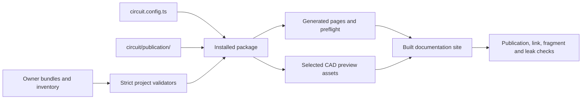

# Component evidence and documentation architecture

The component catalog is a reviewed projection of the project's structured
evidence. It does not replace the evidence, electrical review, or hardware
qualification. Root `CLAUDE.md` remains the authority for current hardware state,
measured limits and repository storage rules; `circuit/WORKFLOW.md` defines the
agent workflow.

## Ownership and data flow

The installed `@takazudo/zudo-circuit-doc` package owns generic validation,
provider adaptation, publication policy machinery, rendering, UI islands and the
CLI. Its project inputs come from root `circuit.config.ts`. This repository owns
the component evidence, the exact publication matrix and selection, CAD assets,
authored rationale, root scripts and project-specific checks.

| Path | Owner | Contract |
| --- | --- | --- |
| `.claude/skills/component-*/` | Evidence owners | Exact part facts, provenance, coverage, routing, interactions and pin maps |
| `.claude/skills/component-spec-audit/references/inventory.json` | Project | Orderable identities and placements, checked against five configured inventory inputs (A/B/P/P15/B20) |
| `.claude/skills/component-spec-audit/references/candidates.json` | Project | Validated alternatives that are not inventory records or published parts |
| `.claude/skills/circuit-spec-integration/references/rules.json` | Project | Eleven current cross-component rules, their inputs, conditions and open evidence stages |
| `circuit.config.ts` | Project | Provider (`led-generator-v1`), Board A/B/P/P15/B20 bindings, package paths, Python floor and preview configuration |
| `circuit/publication/` | Project | Reviewed field matrix, selected records/sources, asset allowlist, document audit and integration gloss |
| `@takazudo/zudo-circuit-doc` | Package | Generic validator, projection, renderers, islands and CLI |
| `patches/@takazudo__zudo-circuit-doc@0.3.0.patch` | Temporary component-package bridge | One built-site checker branch: a document-unavailable record may link its own declared model ([#210](https://github.com/Takazudo/zudo-pd/issues/210)) |
| `doc/src/content/docs/components/**` | Generator | Generated catalog, record and integration pages; never edit by hand |
| `circuit/generated/preflight.json` | Generator | Deterministic publication report; never edit by hand |
| `doc/public/assets/component-previews/**` | Generator | Selected footprint SVGs and WRL models; never edit by hand |
| `circuit/tests/` and `circuit/scripts/` | Project | Corpus, publication, host, workflow, links, model and hardware-specific checks; no alternate generator |

The evidence flow is:



The configured provider is `led-generator-v1`. It binds placement identity and
placement-level DNP state to `scripts/schgen/board_a_spec.py`,
`board_b_spec.py`, `board_p_spec.py`, `board_p15_spec.py` and `board_b20_components.py`.
The pure-Python schematic regeneration gate in `circuit/scripts/run-python-gates.sh` covers four generators
A/B/P/P15; B20 inventory projection is not a fifth regeneration gate. The finite value-field MPN exception
is `C144397`; the setting is in `circuit.config.ts`. The canonical
direct-routing fixture is
`.claude/skills/component-spec-audit/fixtures/direct-routing.json`.

## Published contract

Current counts are defined by the [inventory](../.claude/skills/component-spec-audit/references/inventory.json),
[publication selection](publication/selection.json) and [generated preflight](generated/preflight.json).
Run `pnpm circuit:check` and read its actual SCOPE output; counts are review locks, not measurements or suitability.

The reviewed publication matrix in `circuit/publication/` preserves earlier decisions and
allows selected footprint/model previews. Its denied fields remain unchanged,
including raw evidence extracts, identity owner routes and binary content.
Publication selection separates curated document selections from the documented
honest `rec-c335982` document exception. Its distributor identity stays visible
with distributor authority; no manufacturer PDF is invented. The retained
`document-verification.json` records its dated source audit, mirrors and
referer-gated retrieval history. It is provenance, not a claim of a new live URL
check.

The package projects claims without rewriting them. A source link, generated
preview, complete evidence contract or clean site check does not establish
physical fit, measured performance, assembly state or hardware sign-off. Keep
`NEEDS BENCH`, `UNSOURCED`, `OPEN` coverage and explicit refusal reasons visible.

## Package and patch provenance

The root workspace installs `@takazudo/zudo-circuit-doc` 0.3.0, `@takazudo/zudo-doc`
9.1.4 and the zfb 5.2.2 family from one root lockfile; root and `doc/` resolve the same
installed modules. The released 0.3.0 runtime supplies the contracts the retired 0.1.0
patch bridged: configured board/spec bindings and placement fit
([circuit-doc #103](https://github.com/Takazudo/zudo-circuit-doc/issues/103)), candidate
ownership and evidence partition ([#104](https://github.com/Takazudo/zudo-circuit-doc/issues/104)),
independent document, footprint and model resolution
([#105](https://github.com/Takazudo/zudo-circuit-doc/issues/105)), nullable denied owner
fields and canary harvesting ([#106](https://github.com/Takazudo/zudo-circuit-doc/issues/106)),
safe scanning of declared public canonical footprint hashes
([#107](https://github.com/Takazudo/zudo-circuit-doc/issues/107)), the foreground browser
launcher ([#108](https://github.com/Takazudo/zudo-circuit-doc/issues/108)) and long-identity
viewer layout ([#109](https://github.com/Takazudo/zudo-circuit-doc/issues/109)). zudo-doc 9.1.4
supplies the built heading-ID parity the 5.27.0 patch bridged
([zudo-doc #4428](https://github.com/zudolab/zudo-doc/issues/4428), project
[#211](https://github.com/Takazudo/zudo-pd/issues/211)). `pnpm test:compatibility` and the
heading-parity tests check that installed behavior.

One narrow pnpm patch remains: 0.3.0's built-site checker rejects the model card's own
"Open model file" link on a document-unavailable record, so it is allowed only for that
section's declared WRL ([zudo-pd #210](https://github.com/Takazudo/zudo-pd/issues/210)).
The generic asset-viewer exclusion is host configuration, not a scanner exception, and
dialog accessibility follows the package's media-label contract
([#110](https://github.com/Takazudo/zudo-circuit-doc/issues/110)). See
[`patches/README.md`](../patches/README.md).

The package's current generic view model is version 2. The renderer owns the
`zcd-*` components and stylesheet; the host registers
`circuitDocMdxExtras` in `doc/src/chrome-bindings.tsx` and imports the package
stylesheet from `doc/src/styles/global.css`. The project retains the 12-record
browser smoke because its named cases include the c335982 document gap and the
illustrative inductor model note that scaffold auto-selection cannot guarantee.

## Commands and gates

Run these from the repository root:

| Command | Purpose |
| --- | --- |
| `pnpm circuit:check` | Strict project validator and forward checks, followed by package validation |
| `pnpm circuit:generate` | Generate pages and preflight report from the installed package |
| `pnpm check` | Generated-output, preview/model parity, CAD pairs and host type checks |
| `pnpm build` | Strict project preparation, selected model publication, generation and static site build |
| `pnpm check:site` | Built-reference, publication/leak, strict link, authored-fragment and source-warning checks |
| `pnpm circuit:check-generated` | Re-run project preparation twice; catch drift, untracked output, deletion and non-idempotence |
| `pnpm test:circuit` | Project corpus, evidence, publication, workflow, link and package regressions |
| `pnpm test:compatibility` | Installed-package CLI, mutation regressions and TypeScript declaration consumer |
| `pnpm b4push` | Complete heavy local gate behind one outer `heavy-guard.sh` call |
| `pnpm test:model-viewer:browser` | Separate project browser gate over 12 representatives × two widths × two themes |

PR and production workflows install from the frozen root lock. They retain
`--intent-to-add` drift checks for generated pages, preflight and previews so
new or deleted files are visible. The second preparation proves idempotency.
Production deployment remains secret/domain guarded; the PR workflow retains its
preview alias. Local builds never deploy.

The full b4push command uses the machine-wide heavy guard once around all local
steps. Browser runs use both guards, for example:

```sh
bash "$HOME/.codex/scripts/heavy-guard.sh" -- bash "$HOME/.claude/scripts/playwright-guard.sh" --wait 300 -- pnpm test:model-viewer:browser
```

Exit 75 from the heavy guard means contention and no suite result. Read its
`verdict=` line first, retry `ENV_SUSPECT` once, and defer a persistent
environmental failure. Browser contention also exits 75 and must be retried
through the guard. Exit 4 for missing Chrome is `not run`, not a pass, and does
not satisfy mandatory browser acceptance.

## Historical path references

No active imports, production callers, CI commands or tests load code from the
retired `doc/component-docs/` directory. The remaining literal mentions are
historical or package compatibility provenance:

- `doc/src/content/docs/inbox/wave-7-3d-model-coverage.md` retains its original
  stable historical account of the model work.
- `circuit/tests/runtime.test.mjs` verifies that the installed package still
  accepts the old generated marker during safe ownership takeover.
- `circuit/tests/workflow-contract.test.ts` uses negative assertions to keep
  retired `doc/` command aliases out of the host manifest.
- `patches/README.md`, `doc/SCAFFOLD.md` and this architecture record the
  migration and imported-package provenance.

These references do not call or import the retired implementation. Keep archived
pages and their established URLs intact.
