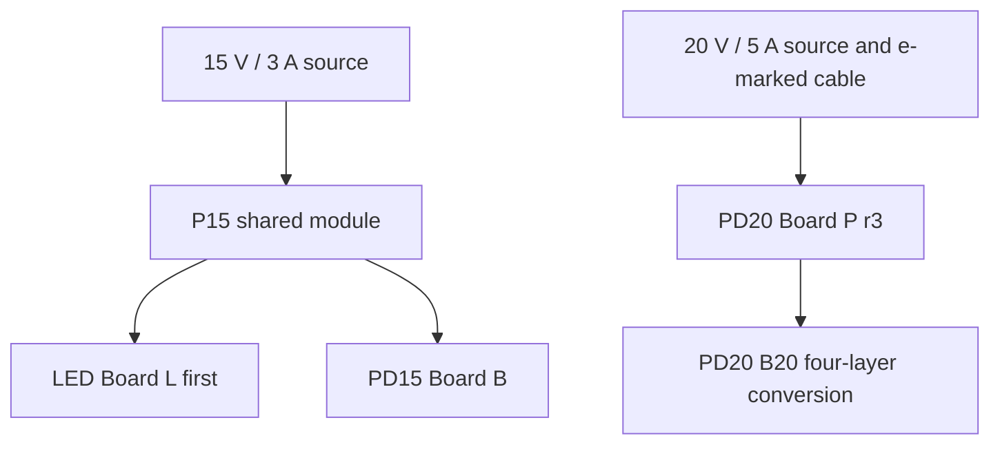

Read [current state](../project/current-state.md) for status and [release readiness](./release-readiness.md) for
acceptance gates. These pages own stable design responsibilities:

- [P15 shared input](./p15-shared-input.md): common 15 V / 3 A module for LED first, then PD15.
- [PD15](./pd15.md): P15 plus Board B; intermediate converters and linear post-regulation.
- [PD20](./pd20.md): Board P r3 plus four-layer B20; 20 V / 5 A input intent, no degraded mode.
- [Board contract](./board-contract.md): variant-specific interfaces and PD15 mounting/probes.
- [Component map](./component-map.md): component ownership and evidence boundaries.
- [Board P lineage](./board-p.md): resolve the reused path and earlier revision references.
- [P15 NVM programming](./board-p15-programming.md): mandatory per-unit acceptance before either load.

[Positive pre-regulator](./positive-pre-regulator.md) and [power-stage options](./power-stage-options.md) describe
PD15 only. Earlier lineage material remains in sidebars and history with explicit scope.
