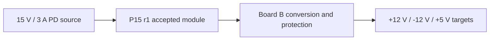

PD15 is the 15 V product: **`board-p15 + board-b`**. P15 is shared with LED; Board B owns synth conversion,
protection and distribution. See [current state](../project/current-state.md#pd15-p15-plus-board-b) for received-unit
identity and checks, and [release gates](./release-readiness.md) for acceptance.

## Source and responsibility

`boards/board-b/board-b.kicad_pcb` is the development layout; `scripts/schgen/board_b_spec.py` owns schematic connectivity.
[Shared P15](./p15-shared-input.md) owns the USB-PD interface. Board B produces +12 V / 1.2 A, −12 V / 0.8 A and
+5 V / 0.5 A **targets**, shared by its sockets and screw terminals.

The AP63201 +13.44 V intermediate and LM2596 +6.519 V / −14.145 V stages feed LT1963A positive and adjustable
LT3015 negative regulation. [Board contract](./board-contract.md), [positive pre-regulator](./positive-pre-regulator.md)
and [power-stage options](./power-stage-options.md) are PD15-specific. They do not describe B20.

## Interface and physical evidence

P15 JOUT1 mates with Board B J5; pin 1/2 VBUS_OUT, 3 ATT, 4 PDOK, 5/6 GND. The unkeyed header requires
pin-by-pin orientation verification. [Board contract](./board-contract.md#seven-top-edge-contacts) owns probe access
and [supports](./board-contract.md#independent-corner-supports) owns installed geometry.

Received Board B matches the S3 factory BOM, not necessarily all S3 fabrication layers or the current development
source. D1 inspection, usable count and LED2 orientation remain open. Historical assembly/leg reports bind their
own sources and do not silently become P15 stack verification. Use [PD15 bring-up](../verification/renewal-bring-up.md)
only after P15 acceptance and revision-specific Board B identification.
