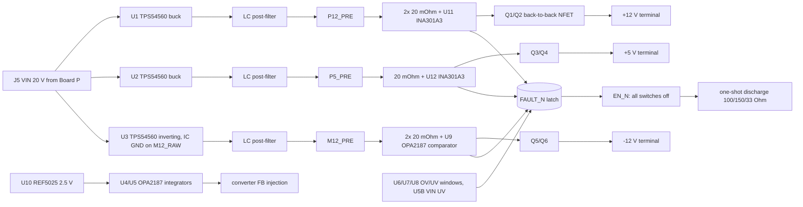

# Board B 20 V switcher-direct draft (unvalidated paper draft)

**Status: unvalidated draft. Nothing here is adopted, measured, simulated, validated or released.**
There is no PCB, no footprint for any new IC, no BOM change and no order file. `PASS` below means
only that the arithmetic in `scripts/pcb/calculate-board-b20-draft.py` closes on its tagged inputs.
`OPEN` means the gate needs data or work that does not exist yet. An `OPEN` gate is not a pass.

- Spec: `scripts/schgen/board_b20_spec.py` → `boards/board-b20-draft/board-b20-draft.kicad_sch` (generated).
- Arithmetic: `python3 scripts/pcb/calculate-board-b20-draft.py` (`--json` for every row).
- Contract: manager `osc-pd-interface-20v.md` (2026-10-31), §0–§6.
- Evidence tags: **G** guaranteed limit from a retained primary extract, **T** typical,
  **PA** project assumption, **PROPOSED** draft value with no owner record.

## 1. Why this is a separate spec

The request was to draft the 20 V switcher-direct design in `board_b_spec.py`. That spec is the
S3 Board B ordered on 2026-09-20. Its schematic, inventory placements, integration rules and
observed forward-test runs describe that ordered board. Rewriting it in place would orphan
every one of those records. It would also make `pnpm circuit:check` describe a board that does
not exist. The draft is therefore a sibling spec. It uses the same generator, symbols and checks,
but it is not bound to the central inventory. Folding it into `board_b_spec.py` is a separate
step for whenever this design is adopted. That step needs a decision record and an as-ordered
snapshot of S3.

## 2. Architecture

- **Converters.** LT3015 and both LT1963A are removed. Three TPS54560DDAR run directly from VIN
  at about 557 kHz (RT 174 kΩ, T). U3 is an inverting buck-boost with its GND and PowerPAD on M12_RAW.
- **Post-filter and sensing.** Each output passes an LC post-filter (ASPI-0630LR 10 µH,
  25SVPF47M, GRM32 10 µF) to its `*_PRE` node. An OPA2187 integrator per rail compares a 0.1 %
  divider of the `*_PRE` node with REF5025. It injects a bounded current through 1 MΩ (4.7 MΩ on
  the inverter) into the converter FB node. The shunt and switch drop are outside this loop and
  are budgeted against the source band. The servo does not sense at the terminal because a
  terminal-sense integrator winds up while the switches are off.
- **Limiter.** +12 V and +5 V use INA301A3 on 20 mΩ shunts in transparent mode, with LIMIT taken
  from REF dividers. −12 V uses an OPA2187 comparator against a 33 Ω / 20.5 kΩ divider from GND to
  M12_PRE. Every trip pulls FAULT_N.
- **Reverse blocking.** Back-to-back CSD18543Q3A common-source pairs sit on every rail. Each pair
  has a BZT52C11 gate-source clamp.
- **Latch and enable.** The fault latch is a BSS138/DMP3036 cross-coupled pair, held reset by
  power-on reset. Only a re-plug clears it. The enable latch is set by PDOK held valid
  for about 150 ms (150 kΩ × 1 µF) and reset by the fault latch.
- **Shutdown.** EN_N turns off all three switch pairs together and fires a one-shot that
  discharges the three terminals.

## 3. Parts

| Part | Use | Evidence |
|---|---|---|
| TPS54560DDAR C31966 | U1–U3 | Candidate record `rec-c31966`, TI SLVSBN0C (G) |
| OPA2187IDGKR C2863562 | U4–U9 | Candidate `rec-c2863562`, TI SBOS807E (G) |
| REF5025AIDR C11341 | U10 | Candidate `rec-c11341`, TI SBOS410O (G). **Standard grade**: 0.1 %, 8 ppm/°C |
| PE1206FRF470R02L C164156 | five shunts | Candidate `rec-c164156`, YAGEO product sheet (G). JLC stock was 51 at retrieval |
| INA301A3IDGKR C2861552 | U11, U12 | Existing candidate `rec-c2861552`, SBOS713A (G) |
| CSD18543Q3A, BSS138, DMP3036SFG-7, BZT52C11, ASPI-0630LR, 25SVPF47M, GRM32 10 µF, RT0603 0.1 % values, project 0603/0805 passives | switches, logic, filters, dividers | Existing owner records |
| Values labelled `R_PROPOSED` / `C_PROPOSED` | FB tops, EN dividers, compensation, window dividers, servo injection, discharge loads, one-shot | **PROPOSED**, no owner record |

The four new parts are in `.claude/skills/component-board-b20-draft-candidates/` as SHORTLISTED
candidates. The draft symbols are in `symbols/zudo-pd.kicad_sym`. Footprints named `*_DRAFT`
do not exist; native ERC reports them as 20 `footprint_link_issues` warnings.

## 4. Gate table against the OSC–PD contract

| Contract item | Result | Basis |
|---|---|---|
| Source band, ripple excluded (§0) | **PASS** | +12: 12.021–12.195 V; −12: 12.020–12.182 V; +5: 5.0501–5.0979 V. Inputs: REF 0.1 % + 30 ppm/mA × 1.5 mA + 8 ppm/°C × 20 °C, 0.1 % dividers, OPA VOS, shunt and RDS(on) maximum (G/PA). +5 V clears the floor by only 0.1 mV |
| Ripple at load < 1 mVp-p (§0) | **OPEN** | §5 below. Ideal LC arithmetic gives 18 / 12 / 45 µVp-p; no simulation or measurement exists |
| Limiter trip window (§1) | **PASS** | +12: 2.006–2.092 A; +5: 0.438–0.461 A; −12: 1.903–1.996 A |
| No trip on the startup ramp (§1, §5) | **PASS** | Steepest slopes are at or below the 10 ms slopes, so ceiling-capacitance startup current is at most the contract's 1759.5 / 1658.2 / 283.4 mA. That is below every trip minimum |
| Maximum never delivered (let-through) (§1) | **OPEN** | The limiter trips; it does not regulate current. Short-circuit current before switch-off depends on unsourced impedances |
| Any trip → all-rail latched shutdown, re-plug only (§1) | **PASS (topology)** | FAULT_N is shared; the latch has no retry path. Timing is not simulated |
| Reverse blocking on all rails (§2) | **PASS (topology)** | Back-to-back NFET pairs on all three rails |
| Reverse current ≤ 1 mA (§2) | **OPEN** | Terminal divider currents are 0.23 / 0.50 / 0.12 mA (CALCULATED). FET leakage is not retained as a guaranteed value. During the discharge one-shot the discharge loads draw up to 0.08–0.16 A from an externally held inlet. Discharge and the 1 mA limit conflict and need joint agreement |
| Discharge time ≤ 100 ms (§3) | **PASS** | 57.9 / 81.7 / 8.6 ms at ceiling capacitance and zero load; the one-shot lasts at least 0.573 s |
| Discharge order (§3): +5 V ≤ 0.8 V before an analog rail is absent; analog rails together | **PASS at zero load** | +5 V reaches 0.8 V at 7.4 ms; +12 V absent at 57.9 ms; −12 V at 81.7 ms with \|−12\| = 1.45 V when +12 V is absent (≤ 6 V). The capacitance ratio window is C+/C− 0.337–1.411 |
| Discharge order with load (§3) | **OPEN** | Load current during shutdown is not specified; an asymmetric load reorders the rails |
| Disconnect skew ≤ 1 ms (§3) | **OPEN** | One EN_N net drives all three gate pull-downs; switching times are not calculated |
| Monotonic common ramp ≥ 10 ms (§5) | **PASS** | Steepest 1.208 / 0.703 / 0.442 V/ms against limits of 1.23 / 1.22 / 0.51. Ramps take at least 16.6 / 17.2 / 13.5 ms |
| Start skew ≤ 0.41 ms (§5) | **OPEN** | 4.65 ms worst over an assumed FET threshold band (PA). No guaranteed transfer curve exists |
| Band-entry skew ≤ 2 ms; +5 V up last (§5) | **OPEN** | Nominal entries are −12 V 21.7 ms, +12 V 22.0 ms, +5 V 22.2 ms, so +5 V is last only nominally. Worst-case skew is 9.77 ms |
| OV/UV windows (§6) | **PASS** | All three rails fit, using actual E192 resistor values |
| VIN undervoltage (§6) | **PASS** | Trips at 16.86–17.03 V, below 19 V (PA). The U5B input is 1.86 V at the Board P overshoot bound, within (V+) − 2 V |
| Contract detect before enable (§6) | **PASS (topology), polarity UNSOURCED** | RDY needs PDOK valid for about 150 ms (RC). The PDOK polarity (low = valid) is not sourced |
| U4 40 V margin | **PASS** | The LT3015 path is gone. The inverter IC sees VIN + \|Vout\| ≤ 37.6 V against 60 V operating and 65 V absolute (G) |
| Converter current | **PASS** | Switch peaks are 2.73 / 0.90 / 4.01 A against a 6.3 A minimum current limit (G) |
| Switch VGS | **PASS** | +12 V pair 13.2 V maximum and +5 V clamped at 11.6 V, against 20 V (G) |
| Servo trim authority | **PASS** | Required FB current is covered with margin on all three rails across TPS54560 VREF 0.792–0.808 V (G). OPA2187 swing uses the table for each amplifier's supply |
| OPA2187 input range on the 5 V amplifiers | **PASS** | Worst input is 2.503 V against (V+) − 2 V = 3.07 V |
| Servo and converter loop stability | **NOT RUN** | No loop model or simulation |
| Discharge resistor pulse rating | **OPEN** | The PROPOSED 1206 loads have no owner record |
| Inrush from Board P into the B20 input bulk | **OPEN** | Not calculated against the Board P eFuse current limit |

## 5. How the ripple target would be met, and why it stays OPEN

The 1 mVp-p target is met on paper in two stages:

1. **Second-stage LC filter.** Each converter feeds a 10 µH / (47 µF polymer ∥ 10 µF MLCC) filter.
   At 557 kHz the ideal attenuation is 6.4 × 10⁻⁴.
2. **DC accuracy decoupled from ripple.** The servo corrects only the DC setpoint, through a
   1 MΩ or 4.7 MΩ injection resistor and a 100 kΩ / 1 µF integrator. It adds no gain at the
   switching frequency.

Ideal arithmetic gives 18 / 12 / 45 µVp-p at the load. This is **not** evidence that the target is
met:

- ESL, inductor self-resonance, switching-edge spikes, layout coupling and ground return
  dominate above a few MHz. None of them is sourced.
- No circuit simulation exists. No PCB exists to measure.

The gate needs either a SPICE run with the vendor models and the real ESL/SRF data, or a
bench measurement on a built board. The measurement must use a bandwidth stated in the contract.

## 6. Checks run on this draft

| Check | Result |
|---|---|
| `gen_schematic.py` | PASS: 209 components, 599 pin specs |
| `verify_geometry.py` | PASS |
| KiCad 10.0.6 native ERC (pinned image, `flock`) | exit 0. 0 errors and 25 warnings: 20 missing `*_DRAFT` footprints, and 5 `pin_to_pin` warnings on J5's unspecified pins |
| KiCad 10.0.6 native netlist + `verify_netlist.py` | PASS: 110 nets, 599 nodes |
| `calculate-board-b20-draft.py` | No FAIL rows; OPEN and NOT RUN rows as in §4 |
| PCB, DRC, BOM/CPL | NOT RUN: there is no PCB, by request |
