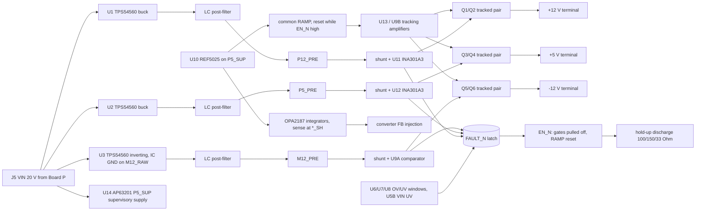

# Board B 20 V switcher-direct draft (unvalidated paper draft)

**Status: unvalidated draft. Nothing here is adopted, measured, validated or released.**
There is no PCB, no footprint for any new IC, no BOM change and no order file. `PASS` below means
only that the arithmetic in `scripts/pcb/calculate-board-b20-draft.py` closes on its tagged inputs,
or that a named ngspice run with vendor models met the limit. A simulation is not a measurement.
`OPEN` means the gate needs data or work that does not exist yet. An `OPEN` gate is not a pass.

- Spec: `scripts/schgen/board_b20_spec.py` → `boards/board-b20-draft/board-b20-draft.kicad_sch` (generated).
- Arithmetic: `python3 scripts/pcb/calculate-board-b20-draft.py` (`--json` for every row).
- Simulation decks, analyzers and summaries: `manufacturing/sim/board-b20-phase7/`.
- Contract: manager `osc-pd-interface-20v.md` (2026-10-31), §0–§6.
- Evidence tags: **G** guaranteed limit from a retained primary extract, **T** typical,
  **PA** project assumption, **PROPOSED** draft value with no owner record.
- Phase 7 folds in the independent review of `bad5ddf`. Section 7 maps every finding.

## 1. Why this is a separate spec

The request was to draft the 20 V switcher-direct design in `board_b_spec.py`. That spec is the
S3 Board B ordered on 2026-09-20. Its schematic, inventory placements, integration rules and
observed forward-test runs describe that ordered board. Rewriting it in place would orphan
every one of those records. It would also make `pnpm circuit:check` describe a board that does
not exist. The draft is therefore a sibling spec. It uses the same generator, symbols and checks,
but it is not bound to the central inventory. Folding it into `board_b_spec.py` is a separate
step for whenever this design is adopted. That step needs a decision record and an as-ordered
snapshot of S3.

## 2. Architecture

- **Converters.** Three TPS54560DDAR run from VIN at about 557 kHz (RT 174 kΩ, T). U3 is an
  inverting buck-boost with its GND and PowerPAD on M12_RAW. Compensation is per stage:
  +12 V 10 kΩ / 6.8 nF / 47 pF, +5 V 4.02 kΩ / 27 nF / 150 pF, inverter 8.2 kΩ / 47 nF / 150 pF.
- **Supervisory supply.** U14 AP63201WU-7 C2071044 makes P5_SUP (4.93–5.04 V) from VIN. It powers
  the reference, every comparator, servo and tracking-reference amplifier, the INA301 VS pins,
  the latches and the discharge hold-up. A +5 V converter fault no longer removes its own supervision.
- **Servo.** OPA2187 integrators compare a 0.1 % divider of each `*_SH` node (after the shunt) with
  REF5025. They inject a bounded current into the converter FB node. Only the switch-pair drop is
  outside the loop. The loop time constant is about 5 ms (5.03 / 5.56 / 5.12 ms), so the rails settle
  long before the earliest enable (RDY ≥ 0.21 s).
- **Common tracking start.** RAMP rises from REF25 through 20 kΩ into 1 µF. A BSS138 holds it at 0 V
  while EN_N is high and for 12–23 ms after enable (RRMD/CRMD). U13 (on VIN) closes +12 = 7.98 × RAMP
  and +5 = 3.32 × RAMP around the switch pairs; U9B closes −12 = −8.06 × RAMP. While disabled, each
  amplifier's feedback input is pre-biased through 100 kΩ and a BSS138 body diode. A 10 MΩ offset to
  M12_PRE sets a small target, so each loop brings its pair to the edge of conduction before RAMP
  moves. The integrators are 10 nF C0G; the −12 V loop adds a 10 kΩ damping zero (RT12NZ).
- **Limiter.** +12 V and +5 V use INA301A3 in transparent mode on their shunts. The LIMIT dividers
  include the 79.2–80.8 µA ILIMIT source current (G). −12 V uses U9A against a divider from GND to
  M12_PRE. Every trip pulls FAULT_N. The limiter trips; it does not regulate current.
- **Reverse blocking.** Back-to-back CSD18543Q3A common-source pairs sit on every rail, with a
  BZT52C11 gate-source clamp on each pair.
- **Latch and enable.** The fault latch Q30/Q31 is held reset for 10.7–36 ms after P5_SUP rises (POR).
  The enable latch is set by RDY (PDOK valid for 0.21–0.73 s) and reset by the fault latch. Only a
  re-plug clears a fault.
- **Shutdown and discharge.** EN_N high pulls all three gates off (the −12 V gate through the Q24/Q25
  level shifter) and resets RAMP. CDH (10 µF) is charged from EN_E only while enabled. When EN_E falls,
  Q56/Q54 drive the discharge switches from CDH alone for 0.48–1.33 s.

## 3. Parts

| Part | Use | Evidence |
|---|---|---|
| TPS54560DDAR C31966 | U1–U3 | Candidate `rec-c31966`, TI SLVSBN0C (G) |
| OPA2187IDGKR C2863562 | servo, window, tracking (U4–U9, U13) | Candidate `rec-c2863562`, TI SBOS807E (G) |
| REF5025AIDR C11341 | U10 | Candidate `rec-c11341`, TI SBOS410O (G). Standard grade: 0.1 %, 8 ppm/°C |
| AP63201WU-7 C2071044 | U14 P5_SUP | Existing owner `component-ap63201-power-stage`; this draft placement is not in the inventory |
| PE1206FRF470R02L C164156 | shunts (draft default) | Candidate `rec-c164156`, YAGEO product sheet (G). JLC stock was 51 at retrieval |
| RLS12FTCR020 C163047 (TA-I) | stock alternative for the 20 mΩ shunts | Candidate `rec-c163047`. Source is an LCSC-hosted manufacturer sheet (MANUFACTURER_MIRROR); facts are **UNSOURCED** until a manufacturer-primary copy is retained. JLC stock 24,785 (read-only lookup, 2026-10-31) |
| INA301A3IDGKR C2861552 | U11, U12 | Existing candidate `rec-c2861552`, SBOS713A (G) |
| CSD18543Q3A, BSS138, DMP3036SFG-7, BZT52C11, ASPI-0630LR, 25SVPF47M, GRM32 10 µF, RT0603 0.1 % values, project 0603/0805/1206 passives | switches, logic, filters, dividers | Existing owner records |
| Values labelled `R_PROPOSED` / `C_PROPOSED` | FB tops, compensation, window dividers, servo injection, tracking network, discharge loads, hold-up | **PROPOSED**, no owner record |

The new ICs are SHORTLISTED candidates in `.claude/skills/component-board-b20-draft-candidates/`.
Footprints named `*_DRAFT` do not exist; native ERC reports them as 21 `footprint_link_issues` warnings.

## 4. Gate table against the OSC–PD contract

| Contract item | Result | Basis |
|---|---|---|
| Source band, ripple excluded (§0) | **PASS** | +12: 12.042–12.196 V; −12: 12.017–12.182 V; +5: 5.0543–5.0981 V. With hot RDS(on) (×1.25, PA) the minimums are 12.026 / 12.001 / 5.0504 V |
| Ripple at load < 1 mVp-p (§0) | **OPEN (averaged + ripple injection, not a switching simulation)** | The vendor TPS54560 transient model still aborts after the phase-8 retry (§5). Injecting the switching current into the linear filter network gives 22.6 / 13.4 / 43.6 µVp-p at the output, with PA ESL and no SRF, coupling or ground-return terms. §5 |
| Limiter trip window (§1) | **PASS** | +12: 2.0032–2.0898 A; +5: 0.4369–0.4608 A; −12: 1.9025–1.9967 A, including ILIMIT × R_TH (review finding 1) |
| No trip on the startup ramp (§1, §5) | **FAIL as drawn; PASS (PROPOSED retune, shunt evidence G-U)** | Start into the full transient load peaks at I_min × V_terminal,max / V_nom: 2.0327 / 1.9289 / 0.4078 A. As drawn the trip minimums are 2.0032 / 1.9025 / 0.4369 A, so +12 V and −12 V fail. One 10 mΩ 0.1 % 15 ppm/°C shunt (RESI PCSR2512BR010M6, C23067428, distributor listing only) with LIMIT 649 Ω / 2.74 kΩ and −12 V divider 20.3 kΩ / 33 Ω gives 2.0418–2.0847 A and 1.9423–1.9953 A. Not drawn. §5a |
| Maximum never delivered (let-through) (§1) | **OPEN** | The limiter trips; it does not regulate current. A series inductor that holds a hard short below I_MAX for an illustrative 2 µs switch-off needs 1.6 / 5.2 / 0.26 mH, which is infeasible at 2 A; switch-off time has no guaranteed figure. The contract needs let-through stated as charge or time above I_MAX. §5a |
| Any trip → all-rail latched shutdown, re-plug only (§1) | **PASS (topology)** | FAULT_N is shared; the latch has no retry path. The limiter comparators are not in the simulation |
| Reverse blocking on all rails (§2) | **PASS (topology)** | Back-to-back NFET pairs on all three rails |
| Reverse current ≤ 1 mA (§2) | **OPEN** | Divider currents are 0.23 / 0.50 / 0.12 mA (CALCULATED). FET and BSS138 leakage at temperature is not retained as a guaranteed value |
| Discharge time ≤ 100 ms (§3) | **PASS at zero load** | 57.9 / 81.7 / 8.6 ms at ceiling capacitance; the hold-up drives the switches for 0.48–1.33 s |
| Discharge order at zero load (§3) | **PASS** | +5 V at 0.8 V after 7.4 ms; +12 V absent at 57.9 ms; −12 V at 81.7 ms with \|−12\| = 1.45 V (≤ 6 V). C+/C− window 0.337–1.411 |
| Discharge order under load (§3) | **OPEN** | After disconnect each rail falls at I/C into its own load (2.0 A on 180 µF is 11 V/ms). An asymmetric OSC load reorders the rails. Guaranteeing the order needs a tracked ramp-down (RAMP falling while the pairs stay in tracking): a contract change, proposed but not drawn |
| Discharge resistor pulse rating | **OPEN** | The PROPOSED 1206 loads have no owner record or pulse curve |
| Disconnect skew ≤ 1 ms (§3) | **PASS (SIM)** | Run `disR`: source current below 10 mA at 21.4 / 20.0 / 24.0 µs after EN_N; skew 4 µs. Gate below 1 V at 15.9 / 16.5 µs |
| Monotonic common ramp ≥ 10 ms, slope limits (§5) | **FAIL (SIM) in 2 of 7 runs** | Arithmetic slopes 1.108 / 0.461 / 1.119 V/ms PASS. Simulated worst: +12 0.86 V/ms PASS; +5 0.75 V/ms in `rev` (limit 0.51) FAIL; −12 1.55 V/ms in `adv` (limit 1.22) FAIL |
| Start skew ≤ 0.41 ms (§5) | **FAIL (SIM) as drawn; PASS (PROPOSED construction, arithmetic)** | Drawn: 0.55–2.26 ms over the seven runs, kept as measured. The phase-8 clamp construction (§5b) meets the voltage form: +12 V alone ≤ 0.404 V (0.096 V margin to 0.5 V) and the −12 V magnitude ≤ 0.556 V while +12 V ≤ 0.5 V. Not drawn, not simulated |
| Band-entry skew ≤ 2 ms; +5 V up last (§5) | **PASS (SIM)** | 0.98–1.04 ms; +5 V last in all seven runs. Arithmetic: 1.020 ms |
| +12 V lead over \|−12 V\| ≤ 0.5 V (review finding 5) | **PASS (SIM)** | At most 0.24 V; \|−12\| leads +12 by up to 0.61 V, inside the R-VEE 6 V limit |
| OV/UV windows (§6) | **PASS** | All three rails fit, using actual E192 resistor values |
| VIN undervoltage (§6) | **PASS** | Trips at 16.86–17.04 V, below 19 V (PA). The U5B input is 1.86 V at the Board P overshoot bound |
| Contract detect before enable (§6) | **PASS (topology), polarity G-U** | RDY needs PDOK valid for 0.21–0.73 s; POR ends at 36 ms at most. PDOK low = PDO2 explicit contract (POWER_OK_CFG 10b, DS12499 Rev 7 Table 4, mirror authority) |
| Servo settled before enable (review finding 2) | **PASS** | Loop time constants 5.03 / 5.56 / 5.12 ms against RDY ≥ 0.21 s |
| P5_SUP independence (review finding 7) | **PASS (topology), single-fault OPEN** | U14 is separate from the +5 V output chain. A U14 failure still removes all supervision; that single fault is OPEN |
| U4 40 V margin | **PASS** | The inverter IC sees VIN + \|Vout\| ≤ 37.6 V against 60 V operating and 65 V absolute (G) |
| Converter current | **PASS** | Switch peaks 2.73 / 0.90 / 4.01 A against a 6.3 A minimum current limit (G) |
| Switch VGS | **PASS** | +12 V pair 13.2 V maximum, +5 V clamped at 11.6 V, Q25 11.1 V, against 20 V (G). +12 V minimum 4.5 V at VIN UV |
| Servo trim authority | **PASS** | Required FB current is covered on all three rails across TPS54560 VREF 0.792–0.808 V (G) |
| OPA2187 input range (5 V amplifiers) | **PASS** | Worst input 2.503 V against (V+) − 2 V = 3.07 V |
| Converter loop stability | **PASS (SIM, average model)** | §5. Phase margin ≥ 82° (+12), ≥ 88° (+5), ≥ 58° (−12 at light load, 21 V); gain margin ≥ 13.4 dB |
| Inrush from Board P into the B20 input bulk | **OPEN** | Board P now slews its Q1 closure (Board P soft-start draft, 3.1–10 V/ms, ≤ 2.5 A into 250 µF); Q1 SOA is not in its bundle |

## 5. Simulation (ngspice in the pinned KiCad 10.0.6 image)

All runs use `ngspice -b` from `kicad/kicad@sha256:18693567…dd3ec`, with `set ngbehavior=psa`.
The vendor models were downloaded from TI's model pages on 2026-10-31 and are not retained.

| Model | TI package | SHA-256 of the download |
|---|---|---|
| TPS54560 average model (`AVG.LIB`) | SLVMCU2 | `e74a8842728963360a0342e940ac96ee93b8ec8d21b65005a2b8152202550597` |
| TPS54560 transient model | SLVMCU1 | `e7dbf0f2b5026f18936790dedee28f479eb724ccf19dc7466cf95717a8735883` |
| OPAx187 | SBOMAB6 | `50c3c188a17bca04f2760feac9c5e6350561eb12a1e25d5a2c19b08dcc2b3930` |
| CSD18543Q3A | SLPM286 | `fbf5e0b576e11f2e0a1a65b0b2c589f86a182ae9ef5c412a0b0b98cd8c569715` |

The CSD18543Q3A library needed a syntax-only copy for ngspice: five `.PARAM name value` lines became
`name=value`. The original library file hashes to `fa4ef721…ba170`. No vendor BSS138, DMP3036 or
BZT52 model was obtained (the Diodes site refused the download). Those parts appear as ideal or
generic elements in the decks, and their results are therefore tagged PA.

### Converter loop stability (average model)

The average model's COMP node is referenced to absolute ground, so the inverter is simulated with the
simulator ground on the IC GND (M12_RAW) and system ground as a separate node. Four corners per rail:
VIN 19 / 21 V × full / light load.

| Rail | Crossover | Phase margin | Gain margin |
|---|---|---|---|
| +12 V | 5.2–5.3 kHz | 82–93° | ≥ 13.8 dB |
| +5 V | 5.0 kHz | 88–94° | ≥ 13.4 dB |
| −12 V, Cc 47 nF | 0.63–3.1 kHz | 58–93° (58° at light load, 21 V) | ≥ 16 dB |

With the earlier 12 nF Cc the inverter had 33° at light load and 21 V. That run is why Cc is 47 nF.
The servo integrators are outside this loop; their 5 ms time constant is three decades below crossover.

### Ripple

**Switching model: still NOT RUN.** Phase 8 retried the vendor transient model once with a changed
input: the `FAST=1` model variant and a 1.2 ms deck. It stopped at 0.14 ms with "timestep too small"
at node `x1.u3_n16532327`; the earlier failures were at 0.92 ms on `x1.isw`.

**Averaged + ripple injection (labelled; not a switching simulation).** `ripple_injection()` in
`scripts/pcb/calculate-board-b20-draft.py` replaces each converter by its averaged operating point
plus an injected periodic current at the minimum switching frequency (501 kHz, typ −10 %). It then
takes the periodic steady state of the linear filter network by harmonic superposition. A linear ngspice
transient of the same network was also tried; it stopped with "timestep too small" at a node with no
switching element, so the frequency-domain form is used.

| Rail | Injected current | Stage-1 bank | Output | Limit |
|---|---|---:|---:|---:|
| +12 V | buck triangle 1.256 App at VIN 25.21 V | 27.9 mVp-p | 22.6 µVp-p | 1 mVp-p |
| +5 V | buck triangle 0.809 App | 17.7 mVp-p | 13.4 µVp-p | 1 mVp-p |
| −12 V | inverter diode current, IL 3.27 A, 20 ns edges (PA) | 77.1 mVp-p | 43.6 µVp-p | 1 mVp-p |

The network is the GRM32 stage-1 bank (3 mΩ, 0.5 nH ESL PA per part), the 10 µH post filter at its
68 mΩ DCR maximum, then 25SVPF47M (30 mΩ, 1 nH PA) plus one GRM32, into the I_MAX load. The status
stays **OPEN**: ESL, inductor self-resonance, switch-node coupling, the ground return and the
measurement bandwidth are PA or unsourced, and they set the high-frequency content that a real
measurement would see.

### Tracking start and disconnect

The decks model the converters as stiff sources behind 20 mΩ (PA). They include the shunts, the
tracking amplifiers (vendor OPAx187), the switch pairs (vendor CSD18543Q3A) and the contract maximum
load capacitance. Enable is at 40 ms; `disR` disables at 85 ms. Cases:
`nom`, `adv` (+12/+5 thresholds −0.5 V, −12 +0.5 V), `rev` (opposite), and each again with resistive
loads at I_TRANSIENT_MIN (`*R`). The solver ladder (`run_ladder.sh`) records the variant used.
`disR` stops at 90.3 ms ("timestep too small" in the −12 V FET after switch-off); its disconnect data is complete.

| Run | Ramp start skew | Band entry (ms after enable) +12 / +5 / −12 | Max slope V/ms +12 / +5 / −12 | Peak source A |
|---|---|---|---|---|
| nom | 0.81 ms | 42.98 / 43.13 / 42.09 | 0.71 / 0.48 / 0.83 | 0.13 / 0.06 / 0.15 |
| adv | 1.07 ms | 42.98 / 43.13 / 42.09 | 0.71 / 0.30 / **1.55** | 0.13 / 0.04 / 0.28 |
| rev | 2.26 ms | 42.98 / 43.14 / 42.10 | 0.86 / **0.75** / 0.72 | 0.16 / 0.09 / 0.13 |
| nomR | 0.55 ms | 43.42 / 43.77 / 42.79 | 0.71 / 0.30 / 0.78 | 2.02 / 0.41 / 1.92 |
| advR | 1.01 ms | 43.42 / 43.77 / 42.79 | 0.71 / 0.30 / **1.46** | 2.02 / 0.41 / 1.92 |
| revR | 2.04 ms | 43.42 / 43.77 / 42.79 | 0.79 / **0.56** / 0.73 | 2.02 / 0.41 / 1.92 |
| disR | 0.56 ms | 43.43 / 43.77 / 42.79 | 0.71 / 0.30 / 0.78 | 2.02 / 0.41 / 1.92 |

Ramp start is the first time a rail rises 0.1 V above its pre-bias plateau after RAMP release.
Band entry uses the source-band floor (12.00 / 5.05 / 12.00 V).

**What the runs changed.** The first drawn network (1 nF integrators) limit-cycled at no load:
−12 V rose in steps at up to 6.9 V/ms with 1.2–1.6 A pulses into the load capacitance. Those runs are
kept in `tracking-1nf-archive/`. Raising the integrators to 10 nF and adding the 10 kΩ zero on the
−12 V loop removed the stepping. Two slope rows still fail with the threshold shifts. Start skew still
fails everywhere. Both need a different start scheme; a shared gate-drive reference is one candidate,
and nothing like it is drawn.

**The test load is at the trip edge.** I_TRANSIENT_MIN loads at 12 V become 2.013 A at the 12.05 V
terminal, which is above the +12 V trip minimum. The limiter comparators are not in these decks.

### 5a. Phase 8: start into the full load and let-through (arithmetic)

A resistive load sized at I_TRANSIENT_MIN at the nominal rail draws I_min × V_terminal,max / V_nom
once the rail is up: 2.0327 / 1.9289 / 0.4078 A (`limiter_startup()`). The ramp does not add to that
peak: the load RC (180 µF × 6 Ω = 1.08 ms) is shorter than the servo time constant (about 5 ms), so
V + RC·dV/dt stays below the final V. Judged on peaks, the drawn trip minimums fail on +12 V and −12 V.

| Rail | Startup floor | Drawn trip | Proposed trip (not drawn) | Result |
|---|---:|---:|---:|---|
| +12 V | 2.0327 A | 2.0032–2.0898 A | 2.0418–2.0847 A (1 × 10 mΩ 0.1 %, LIMIT 649 Ω / 2.74 kΩ) | PASS (PROPOSED) |
| −12 V | 1.9289 A | 1.9025–1.9967 A | 1.9423–1.9953 A (1 × 10 mΩ 0.1 %, 10.2k + 10.1k / 33 Ω) | PASS (PROPOSED) |
| +5 V | 0.4078 A | 0.4369–0.4608 A | unchanged | PASS |

The 10 mΩ shunt (RESI PCSR2512BR010M6, C23067428) and its 20 mΩ sibling (PCSR2512BR020M6,
C19690158) are known only from a read-only JLC listing (G-U); no manufacturer datasheet is retained.

Let-through stays **OPEN**. The limiter is a trip, not a regulator. Bounding a hard short below I_MAX
with a series inductor needs L ≥ V × t_off / (I_MAX − trip_max): 1.6 mH (+12 V), 5.2 mH (−12 V) and
0.26 mH (+5 V) at an illustrative 2 µs, and no retained source guarantees t_off.

### 5b. Phase 8: +12 V-first start sequence by construction (PROPOSED, not drawn or simulated)

Each tracking target becomes the minimum of its RAMP term and a clamp derived from the other rails'
actual terminals (`start_sequence_proposal()`). Followers only lag their targets, and the contract
excludes overshoot, so each inequality holds on the outputs regardless of FET thresholds:

- |−12| ≤ 1.10 × V(+12): −12 V cannot start or lead before +12 V.
- V(+12) ≤ 1.10 × |−12| + 0.40 V: +12 V alone stays below the 0.5 V one-rail limit.
- V(+5) ≤ 0.55 × (min(V(+12), |−12|) − OFF_P5), with OFF_P5 = 0 (unconditional) or 1.5 V (P59-A).
- RAMP C rises from 1 µF to 1.5 µF so that every clamped slope stays inside the contract.

Clamp-amplifier and diode errors are taken as 1 % (PA).

| Row | Limit | Construction | Margin |
|---|---|---|---|
| Unconditional: +12 V alone | ≤ 0.5 V | ≤ 0.404 V | 0.096 V |
| Unconditional: −12 V alone | ≤ 6 V | ≤ 0.556 V while +12 V ≤ 0.5 V | 5.44 V |
| Unconditional start skew (time form of the row above) | ≤ 0.41 ms | voltage form met directly | n/a |
| P59-A: −12 V magnitude until +12 V ≥ 5.2 V | ≤ 6 V | ≤ 5.777 V | 0.223 V |
| P59-A: −12 V lead (time form, 0.069 × ramp time) | ≤ 1.15 ms on this ramp | 0.81 ms at 6 V | 0.34 ms |
| P59-A: +12 V lead | no R-VEE limit; ≤ 6.50 ms with +5 V present | single analog rail ≤ 0.404 V | n/a |
| Slopes | 1.23 / 0.51 / 1.22 V/ms | 0.829 / 0.461 / 0.821 V/ms | PASS |
| First band entry / band-entry skew | ≥ 10 ms / ≤ 2 ms | 28.2 ms / 1.53 ms | PASS |
| Pair overdrive at the end of the ramp | > 0 | +12 0.69 V, −12 0.41 V, +5 0.94 / 0.13 V | PASS |

With OFF_P5 = 0, +5 V stays at or below 0.8 V until both analog rails reach 1.47 V, and it starts with
them. With OFF_P5 = 1.5 V (P59-A), the hold extends until both analog rails reach 2.97 V, and +5 V starts
1.81 ms later. That lag breaks the literal "all ramps start within 0.41 ms" row, whose basis is the
+12 V-leading case only.

Holding +5 V ≤ 0.8 V until both analog rails are inside their source bands is not compatible with the
contract. +5 V then needs ≥ 8.33 ms at 0.51 V/ms after analog band entry, against the 2 ms band-entry
skew (PROPOSED) and the one-common-ramp shape (CONTRACT). OSC has to define the level that "both analog
rails up" means.

The 28 ms first band entry is inside the 20–50 ms range that the contract lists only as candidate
PWR-C1; OSC tolerance of slower ramps is unverified.

## 6. Checks run on this draft

| Check | Result |
|---|---|
| `gen_schematic.py` | PASS: 243 components, 682 pin specs |
| `verify_geometry.py` | PASS: 675 spec pins matched |
| KiCad 10.0.6 native ERC (pinned image, `flock`) | exit 0. 0 errors and 26 warnings: 21 missing `*_DRAFT` footprints and 5 `pin_to_pin` warnings on J5's unspecified pins. Two `power_pin_not_driven` errors on U14 were closed with PWR_FLAGs on VIN and GND |
| KiCad 10.0.6 native netlist + `verify_netlist.py` | PASS: 126 nets, 682 nodes |
| `calculate-board-b20-draft.py` | FAIL (SIM) start skew; OPEN let-through, ripple, loaded discharge order; everything else PASS |
| ngspice AC and tracking runs | As in §5 |
| PCB, DRC, BOM/CPL | NOT RUN: there is no PCB, by request |

## 7. Independent review findings (review of `bad5ddf`)

| Finding | Severity | Phase-7 state |
|---|---|---|
| 1. INA301 LIMIT ~80 µA source current omitted | HIGH | **Fixed.** LIMIT dividers recomputed with ILIMIT 79.2–80.8 µA (G): windows above |
| 2. Servo time constants 3.5–19.6 s vs enable at 26–53 ms | HIGH | **Fixed.** Servo senses at `*_SH`, tau about 5 ms; RDY now 0.21–0.73 s |
| 3. No inrush limit from Board P C3 when Q1 closes | HIGH | **Fixed on paper (Board P draft).** Miller soft start C36/Q5/R27: 3.1–10 V/ms, ≤ 2.5 A. Q1 SOA OPEN |
| 4. +2.9 V margin to 28 V rests on typical figures | HIGH | **OPEN.** L7 stays BLOCKING; only the TVS2200 clamp bounds the node (`manufacturing/input-protection-20v.md`) |
| 5. Rail lead 0.51–0.90 V vs ≤ 0.5 V | MEDIUM | **Fixed (SIM).** Common tracking start: +12 leads \|−12\| by at most 0.24 V |
| 6. Zener knee / VGS assumption | MEDIUM | **Fixed.** Gates driven through 10 kΩ; clamp current < 1 mA; the 4.5 V RDS(on) row is used everywhere |
| 7. +5 V buck powering its own supervision | MEDIUM | **Fixed (topology).** U14 P5_SUP. A U14 single fault is OPEN |
| 8. Discharge hold-up | MEDIUM | **Fixed.** CDH charged only while enabled; 0.48–1.33 s window |
| 9. STUSB4500 VBUS sense behind the eFuse | MEDIUM | **OPEN.** Needs DS12499 behaviour with VBUS_P lagging VBUS_IN, or a bench check |
| 10. Timing and margin claims | LOW | **Partly fixed.** RDY is 0.21–0.73 s and POR ends by 36 ms, so they no longer overlap. R14 + R28 = 940 Ω gives 26.7 mA at 25.1 V. Q55 VGS is 11.2 V. The OVP `node_rows` use the fitted 22.57 V. **OPEN:** the 20 mV UVLO margin to vSafe5V (unchanged, trade-off against the OVP divider), the VBEN 3.15 mA sink rating, and the C3 polarity confirmation |
| 11. Shared compensation; OPA2187 input diodes load REF25 | LOW | **Fixed.** Per-stage compensation, verified in §5. The REF5025 load budget is 3.0 mA, including the comparator input-diode current |
