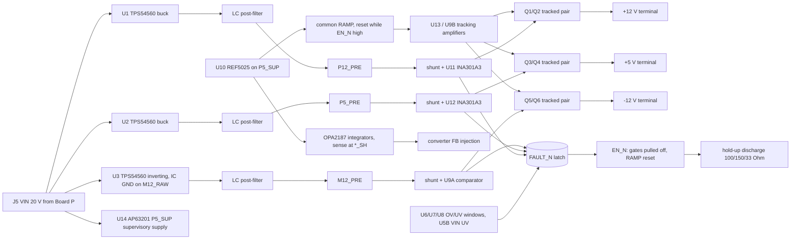

# Board B 20 V switcher-direct draft (unvalidated paper draft)

**Status: unvalidated draft. Nothing here is adopted, measured, validated or released.**
There is no PCB, no footprint for any new IC, no BOM change and no order file. `PASS` below means
only that the arithmetic in `scripts/pcb/calculate-board-b20-draft.py` closes on its tagged inputs,
or that a named ngspice run with vendor models met the limit. A simulation is not a measurement.
`OPEN` means the gate needs data or work that does not exist yet. An `OPEN` gate is not a pass.

- Spec: `scripts/schgen/board_b20_spec.py` → `boards/board-b20-draft/board-b20-draft.kicad_sch` (generated).
- Arithmetic: `python3 scripts/pcb/calculate-board-b20-draft.py` (`--json` for every row).
- Simulation decks, analyzers and summaries: `manufacturing/sim/board-b20-phase7/` (as drawn in phase 7)
  and `manufacturing/sim/board-b20-phase9/` (phase-9 start-order clamps and shunts).
- Contract: manager `osc-pd-interface-20v.md` (2026-10-31), §0–§6.
- Evidence tags: **G** guaranteed limit from a retained primary extract, **T** typical,
  **PA** project assumption, **PROPOSED** draft value with no owner record.
- Phase 7 folds in the independent review of `bad5ddf`. Section 7 maps every finding.

## 1. Why this is a separate spec

The request was to draft the 20 V switcher-direct design in `board_b_spec.py`. That spec is the
S3 Board B ordered on 2026-09-20. Its schematic, inventory placements, integration rules and
observed forward-test runs describe that ordered board. Rewriting it in place would orphan
every one of those records. It would also make `pnpm circuit:check` describe a board that does
not exist. The draft is therefore a sibling spec. It uses the same generator, symbols and checks,
but it is not bound to the central inventory. Folding it into `board_b_spec.py` is a separate
step for whenever this design is adopted. That step needs a decision record and an as-ordered
snapshot of S3.

## 2. Architecture

- **Converters.** Three TPS54560DDAR run from VIN at about 557 kHz (RT 174 kΩ, T). U3 is an
  inverting buck-boost with its GND and PowerPAD on M12_RAW. Compensation is per stage:
  +12 V 10 kΩ / 6.8 nF / 47 pF, +5 V 4.02 kΩ / 27 nF / 150 pF, inverter 8.2 kΩ / 47 nF / 150 pF.
- **Supervisory supply.** U14 AP63201WU-7 C2071044 makes P5_SUP (4.93–5.04 V) from VIN. It powers
  the reference, every comparator, servo and tracking-reference amplifier, the INA301 VS pins,
  the latches and the discharge hold-up. A +5 V converter fault no longer removes its own supervision.
- **Servo.** OPA2187 integrators compare a 0.1 % divider of each `*_SH` node (after the shunt) with
  REF5025. They inject a bounded current into the converter FB node. Only the switch-pair drop is
  outside the loop. The loop time constant is about 5 ms (5.03 / 5.56 / 5.12 ms), so the rails settle
  long before the earliest enable (RDY ≥ 0.21 s).
- **Common tracking start.** RAMP rises from REF25 through 20 kΩ into 1.47 µF (CRMP 1 µF + CRMP2 470 nF,
  phase 9). A BSS138 holds it at 0 V
  while EN_N is high and for 56–108 ms after enable (RRMD 100 kΩ / CRMD 470 nF, phase 10; 12–23 ms with
  the earlier 100 nF). U13 (on VIN) closes +12 = 7.98 × RAMP
  and +5 = 3.32 × RAMP around the switch pairs; U9B closes −12 = −8.06 × RAMP. While disabled, each
  amplifier's feedback input is pre-biased through 100 kΩ and a BSS138 body diode. A 10 MΩ offset to
  M12_PRE sets a small target, so each loop brings its pair to the edge of conduction before RAMP
  moves. The integrators are 10 nF C0G; the −12 V loop adds a 10 kΩ damping zero (RT12NZ).
- **Start-order clamps (phase 9, drawn).** Each amplifier now tracks RAMP_x, which is RAMP through 1 kΩ,
  clamped by an OPA2187 and a BSS138 body diode (U15/U16, Q62–Q64, on P5_SUP / M12_PRE) to a level
  from the other rails' outputs: |−12| ≤ 1.095 × V(+12), V(+12) ≤ 1.099 × |−12| + 0.407 V and
  V(+5) ≤ 0.498 × |−12|. U15/U16 use M12_PRE as their negative rail. On a GND rail the clamp could not
  pull RAMP_x below one diode drop, about 0.4 V, which would let |−12| reach about 3 V with +12 V at 0 V.
  §5c.
- **Limiter.** +12 V and −12 V each use one 10 mΩ 0.1 % shunt (RSH1, RSH3: RESI PCSR2512BR010M6,
  distributor listing only, G-U; phase 9). +5 V keeps one 20 mΩ PE1206 shunt. +12 V and +5 V use
  INA301A3 in transparent mode on their shunts. The LIMIT dividers
  include the 79.2–80.8 µA ILIMIT source current (G). −12 V uses U9A against a divider from GND to
  M12_PRE. Every trip pulls FAULT_N. The limiter trips; it does not regulate current.
- **Reverse blocking.** Back-to-back CSD18543Q3A common-source pairs sit on every rail, with a
  BZT52C11 gate-source clamp on each pair.
- **Latch and enable.** The fault latch Q30/Q31 is held reset for 10.7–36 ms after P5_SUP rises (POR).
  The enable latch is set by RDY (PDOK valid for 0.21–0.73 s) and reset by the fault latch. Only a
  re-plug clears a fault.
- **Shutdown and discharge.** EN_N high pulls all three gates off (the −12 V gate through the Q24/Q25
  level shifter) and resets RAMP. CDH (10 µF) is charged from EN_E only while enabled. When EN_E falls,
  Q56/Q54 drive the discharge switches from CDH alone for 0.48–1.33 s.

## 3. Parts

| Part | Use | Evidence |
|---|---|---|
| TPS54560DDAR C31966 | U1–U3 | Candidate `rec-c31966`, TI SLVSBN0C (G) |
| OPA2187IDGKR C2863562 | servo, window, tracking (U4–U9, U13) | Candidate `rec-c2863562`, TI SBOS807E (G) |
| REF5025AIDR C11341 | U10 | Candidate `rec-c11341`, TI SBOS410O (G). Standard grade: 0.1 %, 8 ppm/°C |
| AP63201WU-7 C2071044 | U14 P5_SUP | Existing owner `component-ap63201-power-stage`; this draft placement is not in the inventory |
| PE1206FRF470R02L C164156 | shunts (draft default) | Candidate `rec-c164156`, YAGEO product sheet (G). JLC stock was 51 at retrieval |
| RLS12FTCR020 C163047 (TA-I) | stock alternative for the 20 mΩ shunts | Candidate `rec-c163047`. Source is an LCSC-hosted manufacturer sheet (MANUFACTURER_MIRROR); facts are **UNSOURCED** until a manufacturer-primary copy is retained. JLC stock 24,785 (read-only lookup, 2026-10-31) |
| INA301A3IDGKR C2861552 | U11, U12 | Existing candidate `rec-c2861552`, SBOS713A (G) |
| CSD18543Q3A, BSS138, DMP3036SFG-7, BZT52C11, ASPI-0630LR, 25SVPF47M, GRM32 10 µF, RT0603 0.1 % values, project 0603/0805/1206 passives | switches, logic, filters, dividers | Existing owner records |
| Values labelled `R_PROPOSED` / `C_PROPOSED` | FB tops, compensation, window dividers, servo injection, tracking network, discharge loads, hold-up | **PROPOSED**, no owner record. Phase 13: 10k 0.1 %, 4.02k 1 % and 8.2k 1 % are bound to the owned RT0603 parts (C95204, C705781, C861589). The other 70 placements resolve to distributor listings in `manufacturing/readiness/b20-identity-resolution.json` (no manufacturer document, no owner record), except 27 nF and 47 nF C0G (**UNKNOWN**, no exact 0603 listing found) |
| DW254P-2X8-L0 C4749189 | J10, J11 (phase 13) | Existing owner `component-dealon-dw254p-2x8-l0-c4749189`; pin map as on the current Board B (1/2 −12 V, 3–8 GND, 9/10 +12 V, 11/12 +5 V, 13/14 CV, 15/16 GATE) |

The new ICs are SHORTLISTED candidates in `.claude/skills/component-board-b20-draft-candidates/`.
Footprints named `*_DRAFT` do not exist; native ERC reports them as 21 `footprint_link_issues` warnings.

Phase 13 footprint check. None of the five `*_DRAFT` names exists in `footprints/kicad/`. The stock KiCad 10.0.6
library in the pinned image has a same-name-class candidate for each, but no candidate's land pattern has been
compared with the manufacturer drawing (**OPEN**):

| Draft footprint | Placements | Project library | Candidate (not compared) |
|---|---|---|---|
| `VSSOP-8_DGK_DRAFT` | 11: U4–U9, U13, U15, U16 (OPA2187), U11, U12 (INA301) | none | `Package_SO:VSSOP-8_3x3mm_P0.65mm` |
| `HSOP-8_TPS54560DDA_DRAFT` | 3: U1–U3 (TPS54560DDAR) | none | `Package_SO:TI_SO-PowerPAD-8`, `HSOP-8-1EP_3.9x4.9mm_P1.27mm_EP2.41x3.1mm` |
| `SOIC-8_D_DRAFT` | 1: U10 (REF5025AIDR) | none | `Package_SO:SOIC-8_3.9x4.9mm_P1.27mm` |
| `R1206_DRAFT` | 4: RSH2, RX12, RX5, R76 | none (only the capacitor `C1206`) | `Resistor_SMD:R_1206_3216Metric`; LED repository `R1206` (read only) |
| `R2512_DRAFT` | 2: RSH1, RSH3 | none | `Resistor_SMD:R_2512_6332Metric`; LED repository `R2512` (read only) |

## 4. Gate table against the OSC–PD contract

| Contract item | Result | Basis |
|---|---|---|
| Source band, ripple excluded (§0) | **PASS** | +12: 12.042–12.196 V; −12: 12.017–12.182 V; +5: 5.0543–5.0981 V. With hot RDS(on) (×1.25, PA) the minimums are 12.026 / 12.001 / 5.0504 V |
| Ripple at load < 1 mVp-p (§0) | **OPEN (averaged + ripple injection, not a switching simulation)** | The vendor TPS54560 transient model still aborts after the phase-8 retry (§5). Injecting the switching current into the linear filter network gives 22.6 / 13.4 / 43.6 µVp-p at the output, with PA ESL and no SRF, coupling or ground-return terms. §5 |
| Limiter trip window (§1) | **PASS (+12 V and −12 V shunt evidence G-U)** | +12: 2.0418–2.0847 A; +5: 0.4369–0.4608 A; −12: 1.9423–1.9953 A, including ILIMIT × R_TH (review finding 1). Phase 9 draws the 10 mΩ shunts, LIMIT 649 Ω / 2.74 kΩ and the 20.3 kΩ / 33 Ω −12 V divider |
| No trip on the startup ramp (§1, §5) | **PASS (drawn, shunt evidence G-U)** | Start into the full transient load peaks at I_min × V_terminal,max / V_nom: 2.0327 / 1.9289 / 0.4078 A, against trip minimums of 2.0418 / 1.9423 / 0.4369 A. The phase-9 `*R` runs peak at 2.013 / 0.403 / 1.91 A (SIM; limiter comparators not in the decks). §5a, §5c |
| Maximum never delivered (let-through) (§1) | **OPEN** | The limiter trips; it does not regulate current. A series inductor that holds a hard short below I_MAX for an illustrative 2 µs switch-off needs 1.6 / 5.2 / 0.26 mH, which is infeasible at 2 A; switch-off time has no guaranteed figure. The contract needs let-through stated as charge or time above I_MAX. §5a |
| Any trip → all-rail latched shutdown, re-plug only (§1) | **PASS (topology)** | FAULT_N is shared; the latch has no retry path. The limiter comparators are not in the simulation |
| Reverse blocking on all rails (§2) | **PASS (topology)** | Back-to-back NFET pairs on all three rails |
| Reverse current ≤ 1 mA (§2) | **OPEN** | Divider currents are 0.23 / 0.50 / 0.12 mA (CALCULATED). FET and BSS138 leakage at temperature is not retained as a guaranteed value |
| Discharge time ≤ 100 ms (§3) | **PASS at zero load** | 57.9 / 81.7 / 8.6 ms at ceiling capacitance; the hold-up drives the switches for 0.48–1.33 s |
| Discharge order at zero load (§3) | **PASS** | +5 V at 0.8 V after 7.4 ms; +12 V absent at 57.9 ms; −12 V at 81.7 ms with \|−12\| = 1.45 V (≤ 6 V). C+/C− window 0.337–1.411 |
| Discharge order under load (§3) | **OPEN** | After disconnect each rail falls at I/C into its own load (2.0 A on 180 µF is 11 V/ms). An asymmetric OSC load reorders the rails. Guaranteeing the order needs a tracked ramp-down (RAMP falling while the pairs stay in tracking): a contract change, proposed but not drawn |
| Discharge resistor pulse rating | **OPEN** | The PROPOSED 1206 loads have no owner record or pulse curve |
| Disconnect skew ≤ 1 ms (§3) | **PASS (SIM)** | Run `disR`: source current below 10 mA at 21.4 / 20.0 / 24.0 µs after EN_N; skew 4 µs. Gate below 1 V at 15.9 / 16.5 µs |
| Monotonic common ramp ≥ 10 ms, slope limits (§5) | **PASS (SIM) at the I_TRANSIENT_MIN load; FAIL (SIM) at no load: owner exception requested** | Arithmetic: 0.754 / 0.314 / 0.762 V/ms unclamped and 0.845 / 0.425 / 0.834 V/ms clamped, PASS. Phase 10 (§5d, CRMD 470 nF): 0.322 / 0.134 / 0.322 V/ms in all four completed loaded runs. At no load +5 V reaches 0.85–0.90 V/ms (limit 0.51) and −12 V 1.21–1.47 V/ms (limit 1.22, `adv` fails). Phase 9 failed +5 V in every run |
| Re-enable inside the RAMP reset window (§5, interrupted ramp) | **PASS (SIM, phase-12 interlock)** | Phase 12 (§5f): the minimum-off interlock holds every re-enable for 18.6–121 ms (arithmetic). All eight re-entry runs at the shortest hold pass every §5 row. Phase 11 (§5e), without the interlock, failed the slope rows at 6 ms off from steady state |
| Start skew ≤ 0.41 ms (§5) | **Voltage form PASS (SIM, drawn clamps); time form FAIL (SIM)** | Phase 10 (§5d), six completed runs: voltage forms held (worst +12 V 0.433 V while \|−12\| < 0.1 V; \|−12\| 0.523 V while +12 V ≤ 0.5 V); ramp start skew 2.24–3.93 ms. Phase 9 (§5c), ten completed runs: +12 V ≤ 0.408 V while \|−12\| < 0.1 V (limit 0.5 V); \|−12\| ≤ 0.72 V while +12 V ≤ 0.5 V (limit 6 V). Ramp start skew is 1.16–2.42 ms. The 0.41 ms row is the time form of the +12 V-alone limit at the fastest slope; the clamps meet the voltage form without it. Arithmetic: ≤ 0.411 V and ≤ 0.553 V |
| Band-entry skew ≤ 2 ms; +5 V up last (§5) | **PASS (SIM)** | Phase 10: 0.79–0.88 ms, +5 V last in every completed run. Phase 9: 0.74–0.83 ms; +5 V last in every completed run. Arithmetic: 1.500 ms |
| +12 V lead over \|−12 V\| ≤ 0.5 V (review finding 5) | **PASS (SIM)** | Phase 10: at most 0.36 V; \|−12\| leads by up to 0.29 V. Phase 9: at most 0.33 V; \|−12\| leads +12 by up to 0.31 V |
| P59-A: \|−12\| ≤ 6 V until +12 V ≥ 5.2 V | **PASS (SIM)** | At most 5.452 V (arithmetic 5.749 V) |
| +5 V ≤ 0.8 V before both analog rails are "up" | **OPEN (definition)** | As drawn, +5 V ≤ 0.69 V (SIM) while either analog rail is below 1.45 V, and reaches 3.39 V by the time both reach 8 V. Which level means "up" is a question for OSC (§5c) |
| OV/UV windows (§6) | **PASS** | All three rails fit, using actual E192 resistor values |
| VIN undervoltage (§6) | **PASS** | Trips at 16.86–17.04 V, below 19 V (PA). The U5B input is 1.86 V at the Board P overshoot bound |
| Contract detect before enable (§6) | **PASS (topology), polarity G-U** | RDY needs PDOK valid for 0.21–0.73 s; POR ends at 36 ms at most. PDOK low = PDO2 explicit contract (POWER_OK_CFG 10b, DS12499 Rev 7 Table 4, mirror authority) |
| Servo settled before enable (review finding 2) | **PASS** | Loop time constants 5.03 / 5.56 / 5.12 ms against RDY ≥ 0.21 s |
| P5_SUP independence (review finding 7) | **PASS (topology), single-fault OPEN** | U14 is separate from the +5 V output chain. A U14 failure still removes all supervision; that single fault is OPEN |
| U4 40 V margin | **PASS** | The inverter IC sees VIN + \|Vout\| ≤ 37.6 V against 60 V operating and 65 V absolute (G) |
| Converter current | **PASS** | Switch peaks 2.73 / 0.90 / 4.01 A against a 6.3 A minimum current limit (G) |
| Switch VGS | **PASS** | +12 V pair 13.2 V maximum, +5 V clamped at 11.6 V, Q25 11.1 V, against 20 V (G). +12 V minimum 4.5 V at VIN UV |
| Servo trim authority | **PASS** | Required FB current is covered on all three rails across TPS54560 VREF 0.792–0.808 V (G) |
| OPA2187 input range (5 V amplifiers) | **PASS** | Worst input 2.503 V against (V+) − 2 V = 3.07 V |
| Converter loop stability | **PASS (SIM, average model)** | §5. Phase margin ≥ 82° (+12), ≥ 88° (+5), ≥ 58° (−12 at light load, 21 V); gain margin ≥ 13.4 dB |
| Inrush from Board P into the B20 input bulk | **OPEN** | Board P now slews its Q1 closure (Board P soft-start draft, 3.1–10 V/ms, ≤ 2.5 A into 250 µF); Q1 SOA is not in its bundle |

## 5. Simulation (ngspice in the pinned KiCad 10.0.6 image)

All runs use `ngspice -b` from `kicad/kicad@sha256:18693567…dd3ec`, with `set ngbehavior=psa`.
The vendor models were downloaded from TI's model pages on 2026-10-31 and are not retained.

| Model | TI package | SHA-256 of the download |
|---|---|---|
| TPS54560 average model (`AVG.LIB`) | SLVMCU2 | `e74a8842728963360a0342e940ac96ee93b8ec8d21b65005a2b8152202550597` |
| TPS54560 transient model | SLVMCU1 | `e7dbf0f2b5026f18936790dedee28f479eb724ccf19dc7466cf95717a8735883` |
| OPAx187 | SBOMAB6 | `50c3c188a17bca04f2760feac9c5e6350561eb12a1e25d5a2c19b08dcc2b3930` |
| CSD18543Q3A | SLPM286 | `fbf5e0b576e11f2e0a1a65b0b2c589f86a182ae9ef5c412a0b0b98cd8c569715` |

The CSD18543Q3A library needed a syntax-only copy for ngspice: five `.PARAM name value` lines became
`name=value`. The original library file hashes to `fa4ef721…ba170`. No vendor BSS138, DMP3036 or
BZT52 model was obtained (the Diodes site refused the download). Those parts appear as ideal or
generic elements in the decks, and their results are therefore tagged PA.

### Converter loop stability (average model)

The average model's COMP node is referenced to absolute ground, so the inverter is simulated with the
simulator ground on the IC GND (M12_RAW) and system ground as a separate node. Four corners per rail:
VIN 19 / 21 V × full / light load.

| Rail | Crossover | Phase margin | Gain margin |
|---|---|---|---|
| +12 V | 5.2–5.3 kHz | 82–93° | ≥ 13.8 dB |
| +5 V | 5.0 kHz | 88–94° | ≥ 13.4 dB |
| −12 V, Cc 47 nF | 0.63–3.1 kHz | 58–93° (58° at light load, 21 V) | ≥ 16 dB |

With the earlier 12 nF Cc the inverter had 33° at light load and 21 V. That run is why Cc is 47 nF.
The servo integrators are outside this loop; their 5 ms time constant is three decades below crossover.

### Ripple

**Switching model: still NOT RUN.** Phase 8 retried the vendor transient model once with a changed
input: the `FAST=1` model variant and a 1.2 ms deck. It stopped at 0.14 ms with "timestep too small"
at node `x1.u3_n16532327`; the earlier failures were at 0.92 ms on `x1.isw`.

**Averaged + ripple injection (labelled; not a switching simulation).** `ripple_injection()` in
`scripts/pcb/calculate-board-b20-draft.py` replaces each converter by its averaged operating point
plus an injected periodic current at the minimum switching frequency (501 kHz, typ −10 %). It then
takes the periodic steady state of the linear filter network by harmonic superposition. A linear ngspice
transient of the same network was also tried; it stopped with "timestep too small" at a node with no
switching element, so the frequency-domain form is used.

| Rail | Injected current | Stage-1 bank | Output | Limit |
|---|---|---:|---:|---:|
| +12 V | buck triangle 1.256 App at VIN 25.21 V | 27.9 mVp-p | 22.6 µVp-p | 1 mVp-p |
| +5 V | buck triangle 0.809 App | 17.7 mVp-p | 13.4 µVp-p | 1 mVp-p |
| −12 V | inverter diode current, IL 3.27 A, 20 ns edges (PA) | 77.1 mVp-p | 43.6 µVp-p | 1 mVp-p |

The network is the GRM32 stage-1 bank (3 mΩ, 0.5 nH ESL PA per part), the 10 µH post filter at its
68 mΩ DCR maximum, then 25SVPF47M (30 mΩ, 1 nH PA) plus one GRM32, into the I_MAX load. The status
stays **OPEN**: ESL, inductor self-resonance, switch-node coupling, the ground return and the
measurement bandwidth are PA or unsourced, and they set the high-frequency content that a real
measurement would see.

### Tracking start and disconnect

The decks model the converters as stiff sources behind 20 mΩ (PA). They include the shunts, the
tracking amplifiers (vendor OPAx187), the switch pairs (vendor CSD18543Q3A) and the contract maximum
load capacitance. Enable is at 40 ms; `disR` disables at 85 ms. Cases:
`nom`, `adv` (+12/+5 thresholds −0.5 V, −12 +0.5 V), `rev` (opposite), and each again with resistive
loads at I_TRANSIENT_MIN (`*R`). The solver ladder (`run_ladder.sh`) records the variant used.
`disR` stops at 90.3 ms ("timestep too small" in the −12 V FET after switch-off); its disconnect data is complete.

| Run | Ramp start skew | Band entry (ms after enable) +12 / +5 / −12 | Max slope V/ms +12 / +5 / −12 | Peak source A |
|---|---|---|---|---|
| nom | 0.81 ms | 42.98 / 43.13 / 42.09 | 0.71 / 0.48 / 0.83 | 0.13 / 0.06 / 0.15 |
| adv | 1.07 ms | 42.98 / 43.13 / 42.09 | 0.71 / 0.30 / **1.55** | 0.13 / 0.04 / 0.28 |
| rev | 2.26 ms | 42.98 / 43.14 / 42.10 | 0.86 / **0.75** / 0.72 | 0.16 / 0.09 / 0.13 |
| nomR | 0.55 ms | 43.42 / 43.77 / 42.79 | 0.71 / 0.30 / 0.78 | 2.02 / 0.41 / 1.92 |
| advR | 1.01 ms | 43.42 / 43.77 / 42.79 | 0.71 / 0.30 / **1.46** | 2.02 / 0.41 / 1.92 |
| revR | 2.04 ms | 43.42 / 43.77 / 42.79 | 0.79 / **0.56** / 0.73 | 2.02 / 0.41 / 1.92 |
| disR | 0.56 ms | 43.43 / 43.77 / 42.79 | 0.71 / 0.30 / 0.78 | 2.02 / 0.41 / 1.92 |

Ramp start is the first time a rail rises 0.1 V above its pre-bias plateau after RAMP release.
Band entry uses the source-band floor (12.00 / 5.05 / 12.00 V).

**What the runs changed.** The first drawn network (1 nF integrators) limit-cycled at no load:
−12 V rose in steps at up to 6.9 V/ms with 1.2–1.6 A pulses into the load capacitance. Those runs are
kept in `tracking-1nf-archive/`. Raising the integrators to 10 nF and adding the 10 kΩ zero on the
−12 V loop removed the stepping. Two slope rows still fail with the threshold shifts. Start skew still
fails everywhere. Both need a different start scheme; a shared gate-drive reference is one candidate,
and nothing like it is drawn.

**The test load is at the trip edge.** I_TRANSIENT_MIN loads at 12 V become 2.013 A at the 12.05 V
terminal, which is above the +12 V trip minimum. The limiter comparators are not in these decks.

### 5a. Phase 8: start into the full load and let-through (arithmetic)

A resistive load sized at I_TRANSIENT_MIN at the nominal rail draws I_min × V_terminal,max / V_nom
once the rail is up: 2.0327 / 1.9289 / 0.4078 A (`limiter_startup()`). The ramp does not add to that
peak: the load RC (180 µF × 6 Ω = 1.08 ms) is shorter than the servo time constant (about 5 ms), so
V + RC·dV/dt stays below the final V. Judged on peaks, the drawn trip minimums fail on +12 V and −12 V.

| Rail | Startup floor | Drawn trip | Proposed trip (not drawn) | Result |
|---|---:|---:|---:|---|
| +12 V | 2.0327 A | 2.0032–2.0898 A | 2.0418–2.0847 A (1 × 10 mΩ 0.1 %, LIMIT 649 Ω / 2.74 kΩ) | PASS (PROPOSED) |
| −12 V | 1.9289 A | 1.9025–1.9967 A | 1.9423–1.9953 A (1 × 10 mΩ 0.1 %, 10.2k + 10.1k / 33 Ω) | PASS (PROPOSED) |
| +5 V | 0.4078 A | 0.4369–0.4608 A | unchanged | PASS |

The 10 mΩ shunt (RESI PCSR2512BR010M6, C23067428) and its 20 mΩ sibling (PCSR2512BR020M6,
C19690158) are known only from a read-only JLC listing (G-U); no manufacturer datasheet is retained.

Let-through stays **OPEN**. The limiter is a trip, not a regulator. Bounding a hard short below I_MAX
with a series inductor needs L ≥ V × t_off / (I_MAX − trip_max): 1.6 mH (+12 V), 5.2 mH (−12 V) and
0.26 mH (+5 V) at an illustrative 2 µs, and no retained source guarantees t_off.

### 5b. Phase 8: +12 V-first start sequence by construction (proposal; drawn and simulated in §5c)

Each tracking target becomes the minimum of its RAMP term and a clamp derived from the other rails'
actual terminals (`start_sequence_proposal()`). Followers only lag their targets, and the contract
excludes overshoot, so each inequality holds on the outputs regardless of FET thresholds:

- |−12| ≤ 1.10 × V(+12): −12 V cannot start or lead before +12 V.
- V(+12) ≤ 1.10 × |−12| + 0.40 V: +12 V alone stays below the 0.5 V one-rail limit.
- V(+5) ≤ 0.55 × (min(V(+12), |−12|) − OFF_P5), with OFF_P5 = 0 (unconditional) or 1.5 V (P59-A).
- RAMP C rises from 1 µF to 1.5 µF so that every clamped slope stays inside the contract.

Clamp-amplifier and diode errors are taken as 1 % (PA).

| Row | Limit | Construction | Margin |
|---|---|---|---|
| Unconditional: +12 V alone | ≤ 0.5 V | ≤ 0.404 V | 0.096 V |
| Unconditional: −12 V alone | ≤ 6 V | ≤ 0.556 V while +12 V ≤ 0.5 V | 5.44 V |
| Unconditional start skew (time form of the row above) | ≤ 0.41 ms | voltage form met directly | n/a |
| P59-A: −12 V magnitude until +12 V ≥ 5.2 V | ≤ 6 V | ≤ 5.777 V | 0.223 V |
| P59-A: −12 V lead (time form, 0.069 × ramp time) | ≤ 1.15 ms on this ramp | 0.81 ms at 6 V | 0.34 ms |
| P59-A: +12 V lead | no R-VEE limit; ≤ 6.50 ms with +5 V present | single analog rail ≤ 0.404 V | n/a |
| Slopes | 1.23 / 0.51 / 1.22 V/ms | 0.829 / 0.461 / 0.821 V/ms | PASS |
| First band entry / band-entry skew | ≥ 10 ms / ≤ 2 ms | 28.2 ms / 1.53 ms | PASS |
| Pair overdrive at the end of the ramp | > 0 | +12 0.69 V, −12 0.41 V, +5 0.94 / 0.13 V | PASS |

With OFF_P5 = 0, +5 V stays at or below 0.8 V until both analog rails reach 1.47 V, and it starts with
them. With OFF_P5 = 1.5 V (P59-A), the hold extends until both analog rails reach 2.97 V, and +5 V starts
1.81 ms later. That lag breaks the literal "all ramps start within 0.41 ms" row, whose basis is the
+12 V-leading case only.

Holding +5 V ≤ 0.8 V until both analog rails are inside their source bands is not compatible with the
contract. +5 V then needs ≥ 8.33 ms at 0.51 V/ms after analog band entry, against the 2 ms band-entry
skew (PROPOSED) and the one-common-ramp shape (CONTRACT). OSC has to define the level that "both analog
rails up" means.

The 28 ms first band entry is inside the 20–50 ms range that the contract lists only as candidate
PWR-C1; OSC tolerance of slower ramps is unverified.

### 5c. Phase 9: start-order clamps and shunts drawn and simulated

`board_b20_spec.py` now draws the §5a shunts and the §5b construction, with these values:

| Clamp | Network | Bound (arithmetic, 1 % clamp error PA) |
|---|---|---|
| −12 V target | U16A: LVLM12 = P12_OUT × 10.2k / (64.9k + 10.2k) against RAMP_M12 | \|−12\| ≤ 1.0947 × V(+12) |
| +12 V target | U15A: MABS = 0.15 × \|−12\| (100k / 15k); U15B: LVL12 from MABS (8.87k / 92k) and REF25 (30.1k / 10k) | V(+12) ≤ 1.0990 × \|−12\| + 0.407 V |
| +5 V target | U16B: MABS against RAMP_P5 | V(+5) ≤ 0.498 × \|−12\| |
| Common | RCP1–RCP3 1 kΩ from RAMP; Q62–Q64 BSS138 body diodes; U15/U16 on P5_SUP / M12_PRE; RAMP C 1.47 µF | first band entry ≥ 27.65 ms, band-entry skew ≤ 1.50 ms |

Arithmetic (`start_sequence_proposal()`): +12 V alone ≤ 0.411 V (0.089 V margin to 0.5 V); \|−12\|
≤ 0.553 V while +12 V ≤ 0.5 V; \|−12\| ≤ 5.749 V at +12 V = 5.2 V (P59-A, 0.251 V margin); +5 V ≤ 0.8 V
until \|−12\| ≥ 1.623 V (+12 V ≥ 1.468 V).

**Decks.** `manufacturing/sim/board-b20-phase9/gen_tracking.py` writes the phase-7 decks with the
clamps, the 10 mΩ shunts and 1.47 µF. `run_ladder.sh` records the solver variant. Two start modes are
kept. In `tracking/`, stiff sources start from initial conditions (`uic`), as in phase 7. In
`tracking-ramp/`, every source rises from 0 V over 2 ms from a DC operating point.

The clamp amplifiers made the vendor CSD18543Q3A and OPAx187 models fragile in the first
microseconds. A 100 MΩ resistor across Q5 (RCV1) is a simulation-only convergence aid and not a board
part. With it, 10 of 14 runs completed: the `ramp` set has six of seven, and the `uic` set has
`nom`, `adv`, `nomR` and `revR`. `disR` aborts in both modes and in eight extra variants (50 µs and 5 µs
disable edges, gear and trap). The furthest runs fail during the disable edge, before switch-off ("timestep
too small" in a CSD18543Q3A). Its start portion matches
`nomR`. The disconnect path (EN_N to the gates) is unchanged from phase 7, so the phase-7 disconnect row
stands and is not re-simulated. The retained results are in `manufacturing/sim/board-b20-phase9/results.json`.

| Run (mode) | Start skew | Band entry +12 / +5 / −12 (ms after enable) | Max slope V/ms +12 / +5 / −12 | Peak source A |
|---|---|---|---|---|
| nom (ramp) | 1.70 ms | 53.25 / 53.68 / 52.86 | 0.54 / **0.86** / **1.54** | 0.10 / 0.11 / 0.28 |
| adv (ramp) | 2.42 ms | 53.00 / 53.42 / 52.60 | 0.53 / **0.60** / **1.40** | 0.10 / 0.07 / 0.26 |
| rev (ramp) | 1.42 ms | 53.58 / 54.01 / 53.19 | 0.54 / **1.03** / 1.14 | 0.10 / 0.13 / 0.21 |
| nomR (ramp) | 1.42 ms | 53.83 / 54.46 / 53.72 | 0.53 / **0.70** / 1.06 | 2.01 / 0.40 / 1.91 |
| advR (ramp) | 2.12 ms | 53.59 / 54.22 / 53.48 | 0.53 / **0.53** / 1.10 | 2.01 / 0.40 / 1.91 |
| revR (ramp) | 1.16 ms | 54.19 / 54.82 / 54.08 | 0.54 / **0.82** / 0.84 | 2.01 / 0.40 / 1.91 |
| nom (uic) | 1.59 ms | 52.98 / 53.41 / 52.59 | 0.54 / **0.90** / 1.20 | 0.10 / 0.11 / 0.22 |
| adv (uic) | 2.15 ms | 52.76 / 53.19 / 52.37 | 0.53 / **0.61** / 1.20 | 0.10 / 0.07 / 0.22 |
| nomR (uic) | 1.43 ms | 53.69 / 54.31 / 53.57 | 0.53 / **0.72** / 1.09 | 2.01 / 0.40 / 1.91 |
| revR (uic) | 1.18 ms | 54.03 / 54.66 / 53.92 | 0.54 / **0.84** / 0.85 | 2.01 / 0.40 / 1.91 |

| Voltage-form row (contract §5) | Limit | Worst over the 10 runs | Result |
|---|---|---|---|
| +12 V while \|−12\| < 0.1 V | ≤ 0.5 V | 0.408 V | **PASS (SIM)** |
| \|−12\| while +12 V ≤ 0.5 V | ≤ 6 V | 0.722 V | **PASS (SIM)** |
| P59-A: \|−12\| while +12 V < 5.2 V | ≤ 6 V | 5.452 V | **PASS (SIM)** |
| +12 V − \|−12\| | ≤ 0.5 V | +0.333 / −0.309 V | **PASS (SIM)** |
| +5 V while either analog rail < 1.45 V | ≤ 0.8 V | 0.691 V | **PASS (SIM)** |
| +5 V while either analog rail < 8 V | not defined (see the OSC question) | 3.389 V | OPEN |
| Band-entry skew; +5 V last | ≤ 2 ms | 0.74–0.83 ms; +5 V last in all runs | **PASS (SIM)** |
| Slopes | 1.23 / 0.51 / 1.22 V/ms | +5 V exceeds in every run; −12 V in `nom` and `adv` (ramp) | **FAIL (SIM)** |

**What the runs show.** The clamps hold every voltage-form start row in every completed run,
including the threshold-shifted cases, without depending on FET thresholds. The time-form start skew
(1.16–2.42 ms) is no longer the binding test, because the voltage limits it was derived from are met
directly. The slope rows fail. While a target is pinned by its clamp, its pass pair does not stay at the
edge of conduction. When the clamp releases, the loop catches up in a short step: −12 V moves 0.03 → 0.7 V
at up to 1.54 V/ms in `nom` (ramp), and +5 V moves 0.01 → 0.4 V at up to 1.03 V/ms in `rev`. Both steps
are below 0.7 V and carry under 0.3 A of charging current, but they exceed the slope rows as written.
Candidate fixes are not drawn: a small positive offset on each clamped target so the pair stays
biased, or slew-limiting each RAMP_x node directly. Phase 10 (§5d) traces the steps to the start instead and draws a longer RAMP reset delay.

**OSC question: what does "both analog rails up" mean for the +5 V hold?** The contract has three
statements. R-ADG forbids +5 V above 0.8 V with one analog rail absent and the other at 8 V or more.
Row 137 says to bring +5 V up last. The P59-A row says no OSC limit applies "if +5 V stays ≤ 0.8 V until
both analog rails are present". As drawn, +5 V stays ≤ 0.8 V only until both analog rails pass about
1.5 V; it reaches 3.39 V by the time both reach 8 V. The three possible definitions behave differently:

1. **"Present" = above about 1.5 V (as drawn).** One common ramp, start-skew voltage form, band-entry
   skew ≤ 2 ms and +5 V last are all met (SIM). Since the analog rails track within about 10 % of each
   other, the R-ADG state (one absent, the other ≥ 8 V) cannot occur. ADG5412F IN is not guaranteed
   low below the ±5 V supply minimum, so OSC #59 (load-side inhibited enables) still has to cover it.
2. **"Present" = ±5 V, the ADG5412F minimum supply.** +5 V would need its own later ramp. That breaks
   the one-common-ramp shape and the 0.41 ms start-skew row. Band-entry skew ≤ 2 ms would be a new
   design target that has not been shown.
3. **"Present" = inside the source band (12.00 V).** +5 V then needs at least 8.33 ms at 0.51 V/ms after
   analog band entry. That breaks the 2 ms band-entry skew (PROPOSED) and the common-ramp shape
   (CONTRACT).

The question for OSC: does the +5 V hold require definition 1, 2 or 3? If 2 or 3, which of the
common-ramp, start-skew and band-entry-skew rows is OSC prepared to relax?

### 5d. Phase 10: RAMP reset delay lengthened (CRMD 470 nF)

**Mechanism, corrected from §5c.** The phase-9 waveforms show the steps come from the start, not from a
clamp release. At enable every tracking integrator leaves its rail at about 1.2 µA / 10 nF
(|M12_PRE| through the 10 MΩ offset into CT), 0.12 V/ms at the gate. With 100 nF, RAMP was released
about 16 ms after enable (12–23 ms over the Q12 threshold range). The gates were then still about 2 V
from conduction, so each pair started late and caught up in a step.

**Change (drawn).** CRMD rises from 100 nF to 470 nF (C1623, already in the B20 parts list). The release
moves to 56.4–108.1 ms after enable. The gates can then climb at least 6.70 V before the earliest
release (`calculate-board-b20-draft.py`). CSD18543Q3A VGS(th) is not in its bundle, so the climb is
stated rather than compared with a threshold (UNSOURCED). There is no slowest-ramp limit in the
contract. Band entry now comes about 140 ms after enable instead of 53 ms. RDY (≥ 0.21 s) gates enable
and is unaffected. The common ramp now takes about 53 ms from first rise to band entry, beyond the 20–50 ms
PWR-C1 candidate. Part of the lower slope comes from the generic Q12 switch model releasing gradually
as its gate falls slowly (PA). After a disable, RAMP is reset 5.0–16.8 ms later instead of 1.1–3.6 ms. A
re-enable inside that window is the contract's separate interrupted-ramp case; phase 11 (§5e) simulates it.

**Decks.** `manufacturing/sim/board-b20-phase10/` holds the same decks with CDLY 470 nF, disable at
235 ms and stop at 250 ms. The retained results are in `results.json`. ngspice ran without the KiCad
lock, one CPU per run.

| Run (ramp mode) | Solver | Start skew | Band entry +12 / +5 / −12 (ms after enable) | Max slope V/ms +12 / +5 / −12 | Pre-bias plateau V |
|---|---|---|---|---|---|
| nomR / advR / revR | trap | 3.65 ms | 140.60 / 141.30 / 140.51 | 0.32 / 0.13 / 0.32 | 0.088 / 0.030 / 0.055 |
| disR (start portion) | gear; stops at the disable edge | 3.65 ms | 140.61 / 141.31 / 140.52 | 0.32 / 0.13 / 0.32 | same |
| rev (no load) | trap | 3.93 ms | 140.09 / 140.59 / 139.72 | 0.45 / **0.90** / 1.21 | 0.145 / 0.052 / 0.096 |
| adv (no load) | trap, rshunt 1e9 | 2.24 ms | 140.05 / 140.56 / 139.68 | 0.32 / **0.85** / **1.47** | 0.144 / 0.051 / 0.097 |
| nom (no load) | FAILED all seven variants at 0.85 ms, before enable | — | — | — | — |

The three loaded runs are identical, so the ±0.5 V threshold shifts no longer change the start. Every
loop reaches its pre-bias plateau before RAMP moves. The `uic` set failed to converge in every case
(stops between 8 µs and 162 ms) and gives no phase-10 evidence. The phase-9 `uic` rows are not
carried forward as phase-10 results.

| Voltage-form row (contract §5) | Limit | Worst over the six runs | Result |
|---|---|---|---|
| +12 V while \|−12\| < 0.1 V | ≤ 0.5 V | 0.433 V (adv) | **PASS (SIM)** |
| \|−12\| while +12 V ≤ 0.5 V | ≤ 6 V | 0.523 V | **PASS (SIM)** |
| P59-A: \|−12\| while +12 V < 5.2 V | ≤ 6 V | 5.361 V | **PASS (SIM)** |
| +12 V − \|−12\| | ≤ 0.5 V | +0.364 / −0.293 V | **PASS (SIM)** |
| +5 V while either analog rail < 1.45 V | ≤ 0.8 V | 0.637 V | **PASS (SIM)** (definition 1, accepted by OSC) |
| Band-entry skew; +5 V last | ≤ 2 ms | 0.79–0.88 ms; +5 V last in all runs | **PASS (SIM)** |
| Slopes at the I_TRANSIENT_MIN load | 1.23 / 0.51 / 1.22 V/ms | 0.32 / 0.13 / 0.32 V/ms | **PASS (SIM)** |
| Slopes at no load | 1.23 / 0.51 / 1.22 V/ms | 0.45 / 0.90 / 1.47 V/ms | **FAIL (SIM)**: owner exception requested |

**Why no load still steps.** With no load, each source-only pair overshoots its pre-bias target, to
0.14 / 0.05 / 0.10 V. It cannot pull the output back down, so the integrator winds to its rail again
before RAMP moves. The fast part of each step lies between 0.08 and 0.45 V on +5 V and between 0.26 and 0.73 V on −12 V. A bleed that
discharges 180 µF within the reset delay would need well under 300 Ω, a permanent 40 mA or more at
12 V. That is not cheap, so this residual is not fixed in B20.

**Requested owner exception (OSC).** OSC accepted definition 1 for the +5 V hold. It found that no
OSC part limits the +5 V step: at most 120 µF × 1.03 V/ms = 124 mA, inside the 400 mA transient
minimum and 500 mA maximum. The phase-10 no-load +5 V step is lower, at most 0.90 V/ms (108 mA). The
request is a contract exception for the no-load start only: a +5 V excursion of ≤ 0.90 V/ms below
0.45 V, and a −12 V excursion of ≤ 1.47 V/ms below 0.75 V (≤ 265 mA into 180 µF). The −12 V part has
no OSC evaluation yet. Loaded starts meet the slope rows.

### 5e. Phase 11: re-enable inside the RAMP reset window (loaded, nominal)

**Decks.** `manufacturing/sim/board-b20-phase11/` starts the loaded nominal case as in §5d (enable at
40 ms, CRMD 470 nF), disables EN_N and re-enables it 6, 10, 14 or 20 ms later. `reR*` disables at
150 ms, mid-ramp with the rails near 4 V. `reB*` disables at 200 ms, with the rails in band. The phase-9/10
decks never passed the disable edge, so these decks soften it for simulation only: 1 ms EN_N edges, and
the three gate pulldown switches (B10, B11, B25) at 1/35 S instead of 1/3.5 S. Disconnect timing is
therefore not evaluated here. All seven runs completed; `results.json` holds them with the solver variant
of each. The rows below are evaluated from the re-enable to the end of the run.

| Run (re-enable after disable) | RAMP at re-enable | Max slope V/ms +12 / +5 / −12 | +12 V while \|−12\| < 0.1 V | +12 − \|−12\| | Band-entry skew; +5 V last | Result |
|---|---|---|---|---|---|---|
| reR6 / reR10 / reR14 / reR20 | 0.0011 / 0.0004 V | 0.32 / ≤ 0.42 / ≤ 0.71 | ≤ 0.300 V | −0.162 / +0.257 V | 0.79–0.80 ms; yes | **PASS (SIM)** |
| reB10 / reB14 | 0.0006 / 0.0004 V | 0.32 / ≤ 0.27 / ≤ 0.51 | ≤ 0.248 V | −0.162 / +0.200 V | 0.79 ms; yes | **PASS (SIM)** |
| reB6 | 0.049 V | 0.32 / **1.02** / **1.31** | 0.471 V | −0.182 / +0.446 V | 0.79 ms; yes | **FAIL (SIM)**: slope rows |

In every run |−12| stays ≤ 0.53 V while +12 V ≤ 0.5 V, ≤ 5.36 V while +12 V < 5.2 V (P59-A), and +5 V
≤ 0.637 V while either analog rail is below 1.45 V. All rails return to the §5d steady values.

**What breaks.** Only a re-enable 6 ms after a disable from steady state breaks a contract row. At that
point the rails have not discharged (0.07 / 0.12 / 0.09 V) and RAMP is at 0.049 V. +5 V then steps at
1.02 V/ms between 0.02 and 0.40 V, and −12 V at 1.31 V/ms between 0.18 and 0.50 V. The +5 V step is
above the 0.90 V/ms no-load exception requested in §5d. The −12 V step is inside the requested 1.47 V/ms
bound. The rails sit above their pre-bias targets at re-enable, so the steps are likely the §5d no-load
mechanism (inference, not traced). Mid-ramp disables do not break any row at any delay. Phase 12 (§5f) closes the case on the PD side with a
minimum-off interlock instead of an OSC timing rule. During the off interval itself the rails
fall at up to 11 V/ms and leave the start rows: +5 V reaches 1.14 V while an analog rail is below
1.45 V, and +12 − |−12| reaches −0.67 V. That interval belongs to the OPEN discharge-order row.

### 5f. Phase 12: minimum-off interlock (PD side)

**Change (drawn).** The enable latch can no longer be set until a hold-off has run after any disable
or P5_SUP return. Q65 (BSS138, gate EN_E) holds EN_HO at GND while enabled. After a disable, EN_HO
charges from P5_SUP through RHO1 + RHO2 (2 × 150k, C22807) into CHO (1 µF, C15849). Q66 (BSS138) sits in
series with Q38 in the RDY set path and closes only once EN_HO passes its VGS(th). The latch holds through
Q33 / Q34 as before, so Q65 resetting EN_HO does not drop an enable. A P5_SUP brownout leaves EN_HO at
GND (it was held there while enabled), so the hold runs again when P5_SUP returns.

**Arithmetic** (`calculate-board-b20-draft.py`, PASS on tagged inputs). The hold is 18.6–121 ms. The short
end uses VGS(th) 0.5 V (PA minimum; the bundle has only the 1.5 V maximum), CHO at 0.6 µF effective (−40 %,
DC bias and tolerance PA) and P5_SUP high. The long end uses 1.5 V, 1.1 µF and P5_SUP low. The RAMP reset
is engaged by 17.1 ms at the latest, so every re-enable lands after it. 121 ms is below the earliest RDY
(214 ms), so the first start is not delayed. Cost: +2 × C22807, +1 × C15849, +2 × C40912. That is
USD 0.11 per board at the 2026-10-31 catalog tiers, and adds no new BOM line.

**Simulation** (`manufacturing/sim/board-b20-phase12/`, 14 runs, all completed). The decks use the shortest
hold (0.5 V, 0.6 µF: 19 ms) and a behavioural model of the latch.

| Runs | Effective re-enable after disable | Max slope V/ms +12 / +5 / −12 | +12 V while \|−12\| < 0.1 V | +12 − \|−12\| | Band-entry skew; +5 V last | Result |
|---|---|---|---|---|---|---|
| reB6 / reB10 / reB14 / reB20 (in-band disable) | 19.1 / 19.1 / 19.2 / 21.2 ms | 0.32 / 0.13 / 0.32 | ≤ 0.126 V | −0.162 / +0.035 V | 0.79–0.80 ms; yes | **PASS (SIM)** |
| reR6 / reR10 / reR14 / reR20 (mid-ramp disable) | 19.1 / 19.1 / 19.2 / 21.2 ms | 0.32 / 0.13 / 0.32 | ≤ 0.126 V | −0.162 / +0.035 V | 0.79–0.80 ms; yes | **PASS (SIM)** |
| nomR / advR / revR (loaded start) | enable at 40.5 ms (hold already run) | 0.32 / 0.13 / 0.32 | ≤ 0.126 V | −0.162 / +0.089 V | 0.79 ms; yes | **PASS (SIM)**, same as §5d |
| adv / rev (no-load start) | same | 0.32–0.45 / 0.85–0.90 / 1.21–1.47 | ≤ 0.433 V | −0.293 / +0.364 V | 0.87–0.88 ms; yes | **FAIL (SIM)** slope rows, same as §5d |
| nom (no-load start; failed in phase 10, completes now with rshunt 1e9) | same | 0.35 / **0.94** / 0.84 | 0.144 V | −0.197 / +0.100 V | 0.88 ms; yes | **FAIL (SIM)** +5 V slope |

In every run |−12| stays ≤ 0.60 V while +12 V ≤ 0.5 V, ≤ 5.36 V while +12 V < 5.2 V, and +5 V
≤ 0.637 V while an analog rail is below 1.45 V. The phase-11 failure (re-enable 6 ms after an in-band
disable) no longer occurs: the request waits for the hold. **New finding:** the `nom` no-load start,
which phase 10 could not complete, gives +5 V 0.94 V/ms. That is above the 0.90 V/ms bound of the
requested no-load exception (§5d). The exception would have to state ≤ 0.95 V/ms, or the no-load step
needs a fix. This is an OSC question.

## 6. Checks run on this draft

| Check | Result |
|---|---|
| `gen_schematic.py` | PASS: 269 components, 779 pin specs (phase 13: J10/J11 and three owned bindings) |
| `verify_geometry.py` | PASS: 772 spec pins matched (phase 13) |
| KiCad 10.0.6 native ERC (pinned image; phase 10 serialised through `flock`) | exit 0. 0 errors and 56 warnings (phase 13): 21 missing `*_DRAFT` footprints and 35 `pin_to_pin` warnings on the unspecified pins of J5 (5) and J10/J11 (30, the same symbol pin type as on the current Board B). Two `power_pin_not_driven` errors on U14 were closed with PWR_FLAGs on VIN and GND |
| KiCad 10.0.6 native netlist + `verify_netlist.py` | PASS: 142 nets, 779 nodes (phase 13) |
| `calculate-board-b20-draft.py` | FAIL (SIM) start skew (time form); OPEN let-through, ripple, loaded discharge order; ramp slope PASS (SIM) loaded / FAIL (SIM) no load; everything else PASS. Phase 10 uses CRMD 470 nF |
| ngspice AC and tracking runs | As in §5 |
| PCB, DRC, BOM/CPL | NOT RUN: there is no PCB, by request |

## 7. Independent review findings (review of `bad5ddf`)

| Finding | Severity | Phase-7 state |
|---|---|---|
| 1. INA301 LIMIT ~80 µA source current omitted | HIGH | **Fixed.** LIMIT dividers recomputed with ILIMIT 79.2–80.8 µA (G): windows above |
| 2. Servo time constants 3.5–19.6 s vs enable at 26–53 ms | HIGH | **Fixed.** Servo senses at `*_SH`, tau about 5 ms; RDY now 0.21–0.73 s |
| 3. No inrush limit from Board P C3 when Q1 closes | HIGH | **Fixed on paper (Board P draft).** Miller soft start C36/Q5/R27: 3.1–10 V/ms, ≤ 2.5 A. Q1 SOA OPEN |
| 4. +2.9 V margin to 28 V rests on typical figures | HIGH | **OPEN.** L7 stays BLOCKING; only the TVS2200 clamp bounds the node (`manufacturing/input-protection-20v.md`) |
| 5. Rail lead 0.51–0.90 V vs ≤ 0.5 V | MEDIUM | **Fixed (SIM).** Common tracking start: +12 leads \|−12\| by at most 0.24 V |
| 6. Zener knee / VGS assumption | MEDIUM | **Fixed.** Gates driven through 10 kΩ; clamp current < 1 mA; the 4.5 V RDS(on) row is used everywhere |
| 7. +5 V buck powering its own supervision | MEDIUM | **Fixed (topology).** U14 P5_SUP. A U14 single fault is OPEN |
| 8. Discharge hold-up | MEDIUM | **Fixed.** CDH charged only while enabled; 0.48–1.33 s window |
| 9. STUSB4500 VBUS sense behind the eFuse | MEDIUM | **OPEN.** Needs DS12499 behaviour with VBUS_P lagging VBUS_IN, or a bench check |
| 10. Timing and margin claims | LOW | **Partly fixed.** RDY is 0.21–0.73 s and POR ends by 36 ms, so they no longer overlap. R14 + R28 = 940 Ω gives 26.7 mA at 25.1 V. Q55 VGS is 11.2 V. The OVP `node_rows` use the fitted 22.57 V. **OPEN:** the 20 mV UVLO margin to vSafe5V (unchanged, trade-off against the OVP divider), the VBEN 3.15 mA sink rating, and the C3 polarity confirmation |
| 11. Shared compensation; OPA2187 input diodes load REF25 | LOW | **Fixed.** Per-stage compensation, verified in §5. The REF5025 load budget is 3.0 mA, including the comparator input-diode current |
